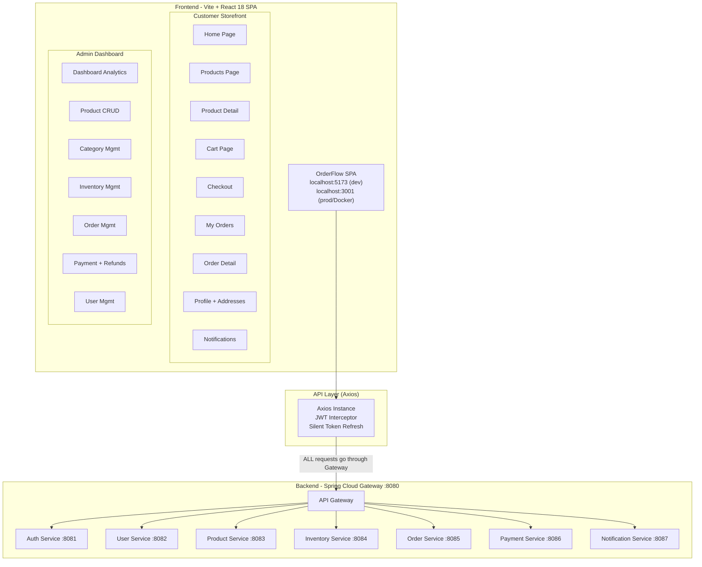
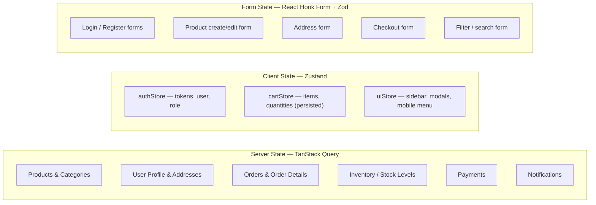
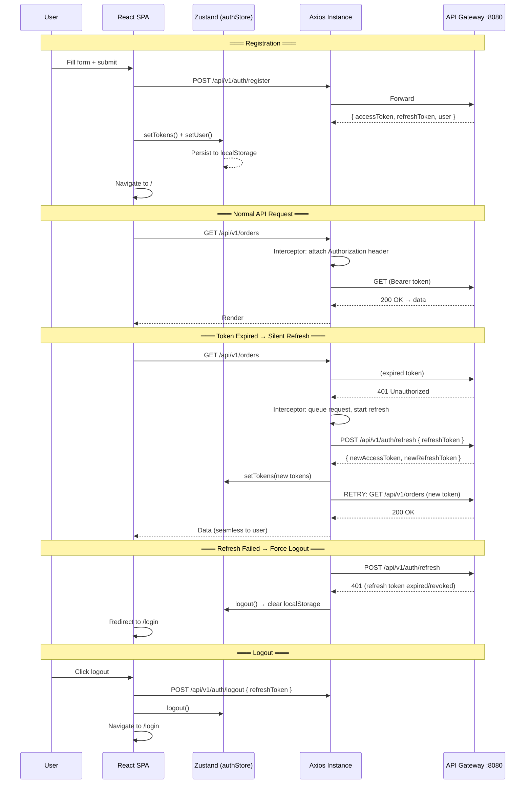

# OrderFlow — Frontend Implementation Plan

**Standalone plan for the industry-grade React SPA frontend**
**Backend reference**: [implementation_plan.md](file:///C:/Users/chetan%20desale/.gemini/antigravity/brain/a6dcd5db-eafb-48e4-bed1-355bb9d37b0a/implementation_plan.md)

---

## 1. Executive Summary

The OrderFlow frontend is an **industry-grade React SPA** built with **Vite + React 18** and **CSS Modules**, featuring a **premium dark-mode glassmorphism** design inspired by Linear, Vercel, and Raycast.

It communicates **exclusively** through the API Gateway (`http://localhost:8080`) to reach all 8 backend Spring Boot microservices. The frontend handles full JWT lifecycle (silent refresh, token rotation), client-side cart with localStorage persistence, real-time order tracking via polling, and a comprehensive admin dashboard.

### Two Major Interfaces

| Interface | Target User | Pages |
|-----------|------------|-------|
| **Customer Storefront** | CUSTOMER role | Home, Products, Product Detail, Cart, Checkout, Orders, Order Detail, Profile, Notifications |
| **Admin Dashboard** | ADMIN role | Analytics Dashboard, Product CRUD, Category Management, Inventory Management, Order Management, Payment/Refund Management, User Management |

---

## 2. Technology Stack

| Layer | Technology | Version | Purpose |
|-------|-----------|---------|---------|
| **Build Tool** | Vite | 5.x | Lightning-fast HMR, ES module bundling |
| **UI Library** | React | 18.3.x | Component-based SPA |
| **Language** | JavaScript (ES2022+) | — | Modern JS with optional JSDoc type hints |
| **Routing** | React Router | 6.x | Client-side routing, protected routes, nested layouts |
| **Server State** | TanStack Query (React Query) | 5.x | Data fetching, caching, background refetch, pagination |
| **Client State** | Zustand | 4.x | Cart, auth tokens, UI state (lightweight, no boilerplate) |
| **HTTP Client** | Axios | 1.7.x | Request/response interceptors for JWT, base URL, errors |
| **Forms** | React Hook Form | 7.x | Performant forms with validation |
| **Validation** | Zod | 3.x | Schema validation (pairs with React Hook Form) |
| **Animations** | Framer Motion | 11.x | Page transitions, micro-interactions, layout animations |
| **Icons** | Lucide React | 0.400+ | Consistent, lightweight SVG icon set |
| **Toasts** | Sonner | 1.x | Premium toast notifications |
| **Date Formatting** | date-fns | 3.x | Lightweight date utilities |
| **Styling** | CSS Modules | Built-in (Vite) | Scoped, maintainable, zero-runtime CSS |
| **Charts (Admin)** | Recharts | 2.x | Admin dashboard analytics charts |
| **Testing** | Vitest + React Testing Library | — | Unit + component testing |
| **Linting** | ESLint + Prettier | — | Code quality |

### Scaffolding Commands

```bash
# 1. Create Vite project
npm create vite@latest ./ -- --template react

# 2. Production dependencies
npm install react-router-dom @tanstack/react-query zustand axios \
  react-hook-form @hookform/resolvers zod framer-motion lucide-react \
  sonner date-fns recharts

# 3. Dev dependencies
npm install -D vitest @testing-library/react @testing-library/jest-dom \
  jsdom eslint prettier @vitejs/plugin-react
```

---

## 3. Full-Stack Architecture (Frontend Perspective)



> [!IMPORTANT]
> The frontend **never** calls microservices directly. Every request goes through the API Gateway at `:8080`, which handles JWT validation, rate limiting, CORS, and routing. In Docker production mode, Nginx proxies `/api/*` to the Gateway container.

---

## 4. Design System — Premium Dark Glassmorphism

### 4.1 Design Philosophy

Inspired by **Linear**, **Vercel Dashboard**, and **Raycast**:

| Principle | Implementation |
|-----------|---------------|
| Deep layered surfaces | 4-level depth system (`bg-root` → `surface-0` → `surface-1` → `surface-2`) |
| Glassmorphism panels | `backdrop-filter: blur(16px)` + semi-transparent backgrounds + border highlights |
| Vibrant accents | Indigo → Violet → Cyan gradient palette with glow effects |
| Precise typography | Inter font, 14px base (dense UI), tight tracking on headings |
| Physics-based motion | Framer Motion spring animations, staggered reveals, layout animations |
| Depth through shadows | Multi-layer shadows with high black opacity for dark theme |

### 4.2 Design Tokens (Complete CSS Custom Properties)

```css
/* ════════════════════════════════════════════════════════
   OrderFlow Design Tokens — index.css :root
   ════════════════════════════════════════════════════════ */
:root {
  /* ─── Backgrounds (Layered depth) ─── */
  --bg-root:         #09090b;
  --bg-surface-0:    #0c0c0f;
  --bg-surface-1:    rgba(17, 17, 21, 0.8);
  --bg-surface-2:    rgba(24, 24, 30, 0.7);
  --bg-surface-3:    rgba(32, 32, 40, 0.6);
  --bg-glass:        rgba(255, 255, 255, 0.03);
  --bg-glass-hover:  rgba(255, 255, 255, 0.06);
  --bg-glass-active: rgba(255, 255, 255, 0.09);

  /* ─── Borders ─── */
  --border-subtle:   rgba(255, 255, 255, 0.06);
  --border-default:  rgba(255, 255, 255, 0.10);
  --border-strong:   rgba(255, 255, 255, 0.15);
  --border-accent:   rgba(99, 102, 241, 0.5);

  /* ─── Text ─── */
  --text-primary:    rgba(255, 255, 255, 0.95);
  --text-secondary:  rgba(255, 255, 255, 0.60);
  --text-tertiary:   rgba(255, 255, 255, 0.40);
  --text-disabled:   rgba(255, 255, 255, 0.25);
  --text-inverse:    #09090b;

  /* ─── Accent Palette (Indigo → Violet → Cyan) ─── */
  --accent-50:       #eef2ff;
  --accent-100:      #e0e7ff;
  --accent-200:      #c7d2fe;
  --accent-400:      #818cf8;
  --accent-500:      #6366f1;
  --accent-600:      #4f46e5;
  --accent-700:      #4338ca;
  --accent-gradient:       linear-gradient(135deg, #6366f1 0%, #8b5cf6 50%, #06b6d4 100%);
  --accent-gradient-hover: linear-gradient(135deg, #818cf8 0%, #a78bfa 50%, #22d3ee 100%);
  --accent-glow:     0 0 20px rgba(99, 102, 241, 0.3), 0 0 60px rgba(99, 102, 241, 0.1);

  /* ─── Semantic Colors ─── */
  --success-500:     #22c55e;
  --success-bg:      rgba(34, 197, 94, 0.10);
  --warning-500:     #f59e0b;
  --warning-bg:      rgba(245, 158, 11, 0.10);
  --error-500:       #ef4444;
  --error-bg:        rgba(239, 68, 68, 0.10);
  --info-500:        #3b82f6;
  --info-bg:         rgba(59, 130, 246, 0.10);

  /* ─── Typography ─── */
  --font-sans:       'Inter', -apple-system, BlinkMacSystemFont, 'Segoe UI', sans-serif;
  --font-mono:       'JetBrains Mono', 'Fira Code', monospace;
  --text-xs:   0.75rem;      /* 12px */
  --text-sm:   0.8125rem;    /* 13px */
  --text-base: 0.875rem;     /* 14px — UI base */
  --text-md:   1rem;         /* 16px */
  --text-lg:   1.125rem;     /* 18px */
  --text-xl:   1.25rem;      /* 20px */
  --text-2xl:  1.5rem;       /* 24px */
  --text-3xl:  1.875rem;     /* 30px */
  --text-4xl:  2.25rem;      /* 36px */
  --text-5xl:  3rem;         /* 48px */
  --font-weight-normal:    400;
  --font-weight-medium:    500;
  --font-weight-semibold:  600;
  --font-weight-bold:      700;
  --leading-tight:   1.25;
  --leading-normal:  1.5;
  --leading-relaxed: 1.625;
  --tracking-tight:  -0.025em;
  --tracking-normal: 0;
  --tracking-wide:   0.025em;

  /* ─── Spacing Scale (4px base) ─── */
  --space-0:   0;
  --space-1:   0.25rem;    /* 4px  */
  --space-2:   0.5rem;     /* 8px  */
  --space-3:   0.75rem;    /* 12px */
  --space-4:   1rem;       /* 16px */
  --space-5:   1.25rem;    /* 20px */
  --space-6:   1.5rem;     /* 24px */
  --space-8:   2rem;       /* 32px */
  --space-10:  2.5rem;     /* 40px */
  --space-12:  3rem;       /* 48px */
  --space-16:  4rem;       /* 64px */
  --space-20:  5rem;       /* 80px */
  --space-24:  6rem;       /* 96px */

  /* ─── Border Radius ─── */
  --radius-sm:   6px;
  --radius-md:   8px;
  --radius-lg:   12px;
  --radius-xl:   16px;
  --radius-2xl:  20px;
  --radius-full: 9999px;

  /* ─── Shadows (Layered depth for dark theme) ─── */
  --shadow-xs:   0 1px 2px rgba(0,0,0,0.3);
  --shadow-sm:   0 2px 4px rgba(0,0,0,0.3), 0 1px 2px rgba(0,0,0,0.2);
  --shadow-md:   0 4px 12px rgba(0,0,0,0.4), 0 2px 4px rgba(0,0,0,0.3);
  --shadow-lg:   0 8px 24px rgba(0,0,0,0.5), 0 4px 8px rgba(0,0,0,0.3);
  --shadow-xl:   0 16px 48px rgba(0,0,0,0.6), 0 8px 16px rgba(0,0,0,0.4);
  --shadow-glow: 0 0 0 1px rgba(99, 102, 241, 0.3), var(--accent-glow);

  /* ─── Glassmorphism ─── */
  --glass-blur:        blur(16px);
  --glass-blur-heavy:  blur(32px);
  --glass-bg:          rgba(255, 255, 255, 0.03);
  --glass-border:      1px solid rgba(255, 255, 255, 0.08);
  --glass-highlight:   inset 0 1px 0 0 rgba(255, 255, 255, 0.05);

  /* ─── Transitions ─── */
  --ease-out:    cubic-bezier(0.16, 1, 0.3, 1);
  --ease-in-out: cubic-bezier(0.65, 0, 0.35, 1);
  --ease-spring: cubic-bezier(0.34, 1.56, 0.64, 1);
  --duration-fast:   150ms;
  --duration-normal: 250ms;
  --duration-slow:   400ms;

  /* ─── Z-Index Scale ─── */
  --z-dropdown:       100;
  --z-sticky:         200;
  --z-modal-backdrop: 300;
  --z-modal:          400;
  --z-toast:          500;
  --z-tooltip:        600;

  /* ─── Layout ─── */
  --sidebar-width:        260px;
  --sidebar-collapsed:    72px;
  --header-height:        64px;
  --max-content-width:    1280px;
  --max-storefront-width: 1440px;
}
```

### 4.3 Typography (Google Fonts)

```html
<!-- index.html <head> -->
<link rel="preconnect" href="https://fonts.googleapis.com">
<link rel="preconnect" href="https://fonts.gstatic.com" crossorigin>
<link href="https://fonts.googleapis.com/css2?family=Inter:wght@400;500;600;700&family=JetBrains+Mono:wght@400;500&display=swap" rel="stylesheet">
```

### 4.4 Key Visual Elements

| Element | CSS Implementation |
|---------|-------------------|
| **Noise texture** | `::after` pseudo-element with SVG noise filter at 2% opacity over entire page |
| **Gradient mesh bg** | Fixed-position radial gradients (indigo + violet + cyan) at 10–15% opacity |
| **Glass cards** | `background: var(--glass-bg); backdrop-filter: var(--glass-blur); border: var(--glass-border);` |
| **Border-light hover** | `border-image: linear-gradient(135deg, transparent, rgba(255,255,255,0.15), transparent) 1` |
| **Animated CTA buttons** | `@keyframes gradient-rotate` on `background-size: 200%` with `background-position` animation |
| **Skeleton loaders** | Shimmer: `background: linear-gradient(90deg, transparent, rgba(255,255,255,0.04), transparent)` |
| **Status badges** | Semantic color pill: colored dot + tinted background + rounded-full |
| **Data tables (admin)** | Alternating row opacity, hover highlight row, sticky blurred header |
| **Focus rings** | `box-shadow: var(--shadow-glow)` on `:focus-visible` |
| **Inputs** | Dark surface, subtle inset shadow, accent glow on focus |

### 4.5 Component Design — GlassCard Example

```css
/* components/common/GlassCard/GlassCard.module.css */
.card {
  background: var(--glass-bg);
  backdrop-filter: var(--glass-blur);
  -webkit-backdrop-filter: var(--glass-blur);
  border: var(--glass-border);
  border-radius: var(--radius-xl);
  box-shadow: var(--glass-highlight), var(--shadow-md);
  padding: var(--space-6);
  transition: all var(--duration-normal) var(--ease-out);
}

.card:hover {
  background: var(--bg-glass-hover);
  border-color: rgba(255, 255, 255, 0.12);
  box-shadow: var(--glass-highlight), var(--shadow-lg);
  transform: translateY(-2px);
}

.card.interactive:active {
  transform: translateY(0);
  background: var(--bg-glass-active);
}

.cardAccent {
  composes: card;
  border-color: var(--border-accent);
  box-shadow: var(--glass-highlight), var(--shadow-glow);
}
```

```jsx
// components/common/GlassCard/GlassCard.jsx
import styles from './GlassCard.module.css';

export default function GlassCard({ children, variant = 'default', className = '', onClick, ...props }) {
  const cardClass = [
    variant === 'accent' ? styles.cardAccent : styles.card,
    onClick ? styles.interactive : '',
    className,
  ].filter(Boolean).join(' ');

  return (
    <div className={cardClass} onClick={onClick} {...props}>
      {children}
    </div>
  );
}
```

---

## 5. Complete Folder Structure

```
orderflow-web/
├── Dockerfile                           # Multi-stage: Node build → Nginx serve
├── nginx.conf                           # SPA fallback + /api proxy to Gateway
├── package.json
├── vite.config.js
├── index.html
├── .env.example                         # VITE_API_BASE_URL=http://localhost:8080
├── .env.development
├── .eslintrc.cjs
├── .prettierrc
├── README.md
│
├── public/
│   ├── favicon.svg
│   ├── og-image.png
│   └── noise-texture.svg
│
└── src/
    ├── main.jsx                          # Entry: providers, router mount
    ├── App.jsx                           # Root component (QueryClientProvider, BrowserRouter, Toaster)
    ├── index.css                         # Global reset + design tokens + base styles
    │
    ├── assets/
    │   └── images/
    │       ├── logo.svg                  # OrderFlow brand mark
    │       ├── hero-gradient.svg         # Hero section bg
    │       ├── empty-cart.svg            # Empty cart illustration
    │       └── empty-orders.svg          # Empty orders illustration
    │
    ├── config/
    │   ├── constants.js                  # API_BASE_URL, PAGE_SIZE, etc.
    │   ├── routes.js                     # Route path constants (ROUTES.HOME, ROUTES.PRODUCTS, etc.)
    │   └── queryKeys.js                  # TanStack Query key factory
    │
    ├── api/                              # 1 file per backend microservice
    │   ├── axiosInstance.js              # Base Axios + JWT interceptors + silent refresh
    │   ├── authApi.js                    # → Auth Service
    │   ├── userApi.js                    # → User Service
    │   ├── productApi.js                 # → Product Service
    │   ├── inventoryApi.js               # → Inventory Service
    │   ├── orderApi.js                   # → Order Service
    │   ├── paymentApi.js                 # → Payment Service
    │   └── notificationApi.js            # → Notification Service
    │
    ├── hooks/
    │   ├── api/                           # TanStack Query hooks — 1 file per domain
    │   │   ├── useAuth.js                 # useLogin, useRegister, useLogout, useRefreshToken
    │   │   ├── useUser.js                 # useProfile, useUpdateProfile, useAddresses, useCRUDAddress
    │   │   ├── useProducts.js             # useProducts, useProduct, useProductBySlug, useCategories
    │   │   ├── useInventory.js            # useStockCheck, useBatchStock
    │   │   ├── useOrders.js               # useOrders, useOrder, useCreateOrder, useCancelOrder
    │   │   ├── usePayments.js             # usePaymentForOrder, useAdminPayments, useRefund
    │   │   └── useNotifications.js        # useNotifications, useNotification
    │   ├── useDebounce.js                 # Debounce search input (300ms)
    │   ├── useMediaQuery.js               # Responsive breakpoint detection
    │   ├── useClickOutside.js             # Close dropdowns/drawers on outside click
    │   └── useIntersectionObserver.js     # Lazy load images, infinite scroll trigger
    │
    ├── stores/                            # Zustand stores (client state only)
    │   ├── authStore.js                   # tokens, user info, isAuthenticated, isAdmin
    │   ├── cartStore.js                   # items[], add/remove/update, totals, localStorage persist
    │   └── uiStore.js                     # sidebar collapsed, active modal, mobile menu open
    │
    ├── components/
    │   │
    │   ├── common/                        # ═══ Primitive/Shared Components ═══
    │   │   ├── Button/
    │   │   │   ├── Button.jsx             # Variants: primary, secondary, ghost, danger, accent-gradient
    │   │   │   └── Button.module.css
    │   │   ├── Input/
    │   │   │   ├── Input.jsx              # Text, email, password, number with label + error
    │   │   │   └── Input.module.css
    │   │   ├── Select/
    │   │   │   ├── Select.jsx
    │   │   │   └── Select.module.css
    │   │   ├── Textarea/
    │   │   │   ├── Textarea.jsx
    │   │   │   └── Textarea.module.css
    │   │   ├── Checkbox/
    │   │   │   ├── Checkbox.jsx
    │   │   │   └── Checkbox.module.css
    │   │   ├── Badge/
    │   │   │   ├── Badge.jsx              # Variants: success, warning, error, info, neutral
    │   │   │   └── Badge.module.css
    │   │   ├── Avatar/
    │   │   │   ├── Avatar.jsx             # Initials fallback, image, size variants
    │   │   │   └── Avatar.module.css
    │   │   ├── Modal/
    │   │   │   ├── Modal.jsx              # Backdrop blur + scale-in animation
    │   │   │   └── Modal.module.css
    │   │   ├── Dropdown/
    │   │   │   ├── Dropdown.jsx
    │   │   │   └── Dropdown.module.css
    │   │   ├── GlassCard/
    │   │   │   ├── GlassCard.jsx
    │   │   │   └── GlassCard.module.css
    │   │   ├── DataTable/
    │   │   │   ├── DataTable.jsx          # Sortable cols, sticky header, row hover, pagination
    │   │   │   └── DataTable.module.css
    │   │   ├── Pagination/
    │   │   │   ├── Pagination.jsx         # Page numbers + prev/next with ellipsis
    │   │   │   └── Pagination.module.css
    │   │   ├── Skeleton/
    │   │   │   ├── Skeleton.jsx           # Shimmer loader: text, card, table row variants
    │   │   │   └── Skeleton.module.css
    │   │   ├── EmptyState/
    │   │   │   ├── EmptyState.jsx         # Icon + title + description + CTA button
    │   │   │   └── EmptyState.module.css
    │   │   ├── StatusBadge/
    │   │   │   ├── StatusBadge.jsx        # Order/payment status with colored dot
    │   │   │   └── StatusBadge.module.css
    │   │   ├── SearchInput/
    │   │   │   ├── SearchInput.jsx        # Search icon + debounced input + clear button
    │   │   │   └── SearchInput.module.css
    │   │   ├── PriceDisplay/
    │   │   │   ├── PriceDisplay.jsx       # Current price + compare-at (strikethrough) + discount %
    │   │   │   └── PriceDisplay.module.css
    │   │   ├── QuantitySelector/
    │   │   │   ├── QuantitySelector.jsx   # [ - ] count [ + ] with min/max bounds
    │   │   │   └── QuantitySelector.module.css
    │   │   ├── Tooltip/
    │   │   │   ├── Tooltip.jsx
    │   │   │   └── Tooltip.module.css
    │   │   ├── Breadcrumb/
    │   │   │   ├── Breadcrumb.jsx
    │   │   │   └── Breadcrumb.module.css
    │   │   ├── Spinner/
    │   │   │   ├── Spinner.jsx            # Animated SVG spinner
    │   │   │   └── Spinner.module.css
    │   │   └── ConfirmDialog/
    │   │       ├── ConfirmDialog.jsx      # "Are you sure?" with cancel/confirm buttons
    │   │       └── ConfirmDialog.module.css
    │   │
    │   ├── layout/                        # ═══ Layout Shells ═══
    │   │   ├── StorefrontLayout/
    │   │   │   ├── StorefrontLayout.jsx   # Navbar + <Outlet/> + Footer
    │   │   │   ├── StorefrontLayout.module.css
    │   │   │   ├── Navbar.jsx             # Logo, nav links, search, cart icon, user menu
    │   │   │   ├── Navbar.module.css
    │   │   │   ├── Footer.jsx             # Links, social icons, newsletter
    │   │   │   ├── Footer.module.css
    │   │   │   ├── CartDrawer.jsx         # Slide-in cart panel from right
    │   │   │   └── CartDrawer.module.css
    │   │   ├── AdminLayout/
    │   │   │   ├── AdminLayout.jsx        # Sidebar + Header + <Outlet/>
    │   │   │   ├── AdminLayout.module.css
    │   │   │   ├── AdminSidebar.jsx       # Nav items with icons, collapsible
    │   │   │   ├── AdminSidebar.module.css
    │   │   │   ├── AdminHeader.jsx        # Breadcrumb, user avatar, logout
    │   │   │   └── AdminHeader.module.css
    │   │   └── AuthLayout/
    │   │       ├── AuthLayout.jsx         # Centered glass card over gradient mesh
    │   │       └── AuthLayout.module.css
    │   │
    │   ├── auth/                          # ═══ Auth Feature Components ═══
    │   │   ├── LoginForm.jsx
    │   │   ├── LoginForm.module.css
    │   │   ├── RegisterForm.jsx
    │   │   └── RegisterForm.module.css
    │   │
    │   ├── product/                       # ═══ Product Feature Components ═══
    │   │   ├── ProductCard/
    │   │   │   ├── ProductCard.jsx        # Image, name, price, stock badge, add-to-cart
    │   │   │   └── ProductCard.module.css
    │   │   ├── ProductGrid/
    │   │   │   ├── ProductGrid.jsx        # Responsive grid container
    │   │   │   └── ProductGrid.module.css
    │   │   ├── ProductFilters/
    │   │   │   ├── ProductFilters.jsx     # Category checkboxes, price range, brand filter
    │   │   │   └── ProductFilters.module.css
    │   │   ├── ProductGallery/
    │   │   │   ├── ProductGallery.jsx     # Main image + thumbnails with zoom
    │   │   │   └── ProductGallery.module.css
    │   │   ├── ProductInfo/
    │   │   │   ├── ProductInfo.jsx        # Name, brand, price, description, SKU
    │   │   │   └── ProductInfo.module.css
    │   │   ├── CategoryNav/
    │   │   │   ├── CategoryNav.jsx        # Horizontal scrollable category pills
    │   │   │   └── CategoryNav.module.css
    │   │   └── StockIndicator/
    │   │       ├── StockIndicator.jsx     # In Stock / Low Stock / Out of Stock with colors
    │   │       └── StockIndicator.module.css
    │   │
    │   ├── cart/                           # ═══ Cart Feature Components ═══
    │   │   ├── CartItem/
    │   │   │   ├── CartItem.jsx           # Product row with quantity selector + remove
    │   │   │   └── CartItem.module.css
    │   │   ├── CartSummary/
    │   │   │   ├── CartSummary.jsx        # Subtotal, tax, total, checkout button
    │   │   │   └── CartSummary.module.css
    │   │   └── CartEmpty/
    │   │       ├── CartEmpty.jsx
    │   │       └── CartEmpty.module.css
    │   │
    │   ├── checkout/                      # ═══ Checkout Feature Components ═══
    │   │   ├── CheckoutStepper/
    │   │   │   ├── CheckoutStepper.jsx    # Step indicator: Address → Review → Confirm
    │   │   │   └── CheckoutStepper.module.css
    │   │   ├── AddressSelector/
    │   │   │   ├── AddressSelector.jsx    # Radio list of saved addresses + add new
    │   │   │   └── AddressSelector.module.css
    │   │   ├── OrderReview/
    │   │   │   ├── OrderReview.jsx        # Items list + totals before placing order
    │   │   │   └── OrderReview.module.css
    │   │   └── PaymentConfirmation/
    │   │       ├── PaymentConfirmation.jsx # Success animation + order number + CTA
    │   │       └── PaymentConfirmation.module.css
    │   │
    │   ├── order/                         # ═══ Order Feature Components ═══
    │   │   ├── OrderCard/
    │   │   │   ├── OrderCard.jsx          # Order summary card for list view
    │   │   │   └── OrderCard.module.css
    │   │   ├── OrderTimeline/
    │   │   │   ├── OrderTimeline.jsx      # Visual Saga progress: Placed → Reserved → Paid → Confirmed → Shipped → Delivered
    │   │   │   └── OrderTimeline.module.css
    │   │   ├── OrderItemsList/
    │   │   │   ├── OrderItemsList.jsx
    │   │   │   └── OrderItemsList.module.css
    │   │   └── OrderStatusBadge/
    │   │       ├── OrderStatusBadge.jsx   # Color-coded status with icon
    │   │       └── OrderStatusBadge.module.css
    │   │
    │   ├── profile/                       # ═══ Profile Feature Components ═══
    │   │   ├── ProfileForm/
    │   │   │   ├── ProfileForm.jsx        # First/last name, phone, DOB
    │   │   │   └── ProfileForm.module.css
    │   │   ├── AddressCard/
    │   │   │   ├── AddressCard.jsx        # Address display with edit/delete actions
    │   │   │   └── AddressCard.module.css
    │   │   └── AddressForm/
    │   │       ├── AddressForm.jsx        # Full address form with label selector
    │   │       └── AddressForm.module.css
    │   │
    │   ├── notification/                  # ═══ Notification Feature Components ═══
    │   │   ├── NotificationItem/
    │   │   │   ├── NotificationItem.jsx
    │   │   │   └── NotificationItem.module.css
    │   │   ├── NotificationBell/
    │   │   │   ├── NotificationBell.jsx   # Navbar bell icon with unread count
    │   │   │   └── NotificationBell.module.css
    │   │   └── NotificationList/
    │   │       ├── NotificationList.jsx
    │   │       └── NotificationList.module.css
    │   │
    │   └── admin/                         # ═══ Admin Feature Components ═══
    │       ├── StatsCard/
    │       │   ├── StatsCard.jsx          # Metric + trend arrow + percentage change
    │       │   └── StatsCard.module.css
    │       ├── RevenueChart/
    │       │   ├── RevenueChart.jsx       # Recharts area chart
    │       │   └── RevenueChart.module.css
    │       ├── OrdersChart/
    │       │   ├── OrdersChart.jsx        # Recharts bar chart by status
    │       │   └── OrdersChart.module.css
    │       ├── ProductForm/
    │       │   ├── ProductForm.jsx        # Create/edit product modal form
    │       │   └── ProductForm.module.css
    │       ├── CategoryForm/
    │       │   ├── CategoryForm.jsx
    │       │   └── CategoryForm.module.css
    │       ├── InventoryForm/
    │       │   ├── InventoryForm.jsx      # Update stock quantity modal
    │       │   └── InventoryForm.module.css
    │       ├── OrderStatusUpdater/
    │       │   ├── OrderStatusUpdater.jsx # Dropdown to ship/deliver + confirmation
    │       │   └── OrderStatusUpdater.module.css
    │       ├── RefundDialog/
    │       │   ├── RefundDialog.jsx       # Refund amount + reason form
    │       │   └── RefundDialog.module.css
    │       └── UserTable/
    │           ├── UserTable.jsx
    │           └── UserTable.module.css
    │
    ├── pages/
    │   ├── storefront/
    │   │   ├── HomePage.jsx               # Hero + featured products + categories + stats
    │   │   ├── HomePage.module.css
    │   │   ├── ProductsPage.jsx           # Grid + filters + search + sort + pagination
    │   │   ├── ProductsPage.module.css
    │   │   ├── ProductDetailPage.jsx      # Gallery + info + stock + add to cart
    │   │   ├── ProductDetailPage.module.css
    │   │   ├── CartPage.jsx               # Cart items list + summary + checkout CTA
    │   │   ├── CartPage.module.css
    │   │   ├── CheckoutPage.jsx           # Multi-step: address → review → place order
    │   │   ├── CheckoutPage.module.css
    │   │   ├── OrdersPage.jsx             # Order history cards + pagination
    │   │   ├── OrdersPage.module.css
    │   │   ├── OrderDetailPage.jsx        # Timeline + items + payment + shipping + cancel
    │   │   ├── OrderDetailPage.module.css
    │   │   ├── ProfilePage.jsx            # Profile form + addresses list
    │   │   ├── ProfilePage.module.css
    │   │   ├── NotificationsPage.jsx      # Notification history list
    │   │   └── NotificationsPage.module.css
    │   │
    │   ├── auth/
    │   │   ├── LoginPage.jsx
    │   │   ├── LoginPage.module.css
    │   │   ├── RegisterPage.jsx
    │   │   └── RegisterPage.module.css
    │   │
    │   ├── admin/
    │   │   ├── DashboardPage.jsx          # Stats cards + revenue chart + orders chart + recent orders
    │   │   ├── DashboardPage.module.css
    │   │   ├── AdminProductsPage.jsx      # DataTable + create/edit modal + delete confirm
    │   │   ├── AdminProductsPage.module.css
    │   │   ├── AdminCategoriesPage.jsx    # Category CRUD table
    │   │   ├── AdminCategoriesPage.module.css
    │   │   ├── AdminInventoryPage.jsx     # Stock levels table + update modal
    │   │   ├── AdminInventoryPage.module.css
    │   │   ├── AdminOrdersPage.jsx        # All orders + status filter + status update
    │   │   ├── AdminOrdersPage.module.css
    │   │   ├── AdminOrderDetailPage.jsx   # Full order detail with admin actions
    │   │   ├── AdminOrderDetailPage.module.css
    │   │   ├── AdminPaymentsPage.jsx      # Payments table + refund dialog
    │   │   ├── AdminPaymentsPage.module.css
    │   │   ├── AdminUsersPage.jsx         # Users table
    │   │   └── AdminUsersPage.module.css
    │   │
    │   └── errors/
    │       ├── NotFoundPage.jsx
    │       ├── NotFoundPage.module.css
    │       ├── ForbiddenPage.jsx
    │       └── ForbiddenPage.module.css
    │
    ├── router/
    │   ├── AppRouter.jsx                  # Route tree with layout nesting
    │   ├── ProtectedRoute.jsx             # Redirects to /login if not authenticated
    │   ├── AdminRoute.jsx                 # Redirects to /403 if not ADMIN role
    │   └── GuestRoute.jsx                 # Redirects to / if already logged in
    │
    └── utils/
        ├── formatCurrency.js              # $1,234.56 formatting
        ├── formatDate.js                  # "Nov 13, 2026 at 2:30 PM"
        ├── formatOrderNumber.js           # "ORD-20261113-001"
        ├── cn.js                          # className merger utility
        ├── validators.js                  # Zod schemas for all forms
        └── storage.js                     # localStorage get/set/remove helpers
```

---

## 6. Routing Architecture

### 6.1 Complete Route Map

| Path | Component | Layout | Auth Guard | Backend Service(s) |
|------|-----------|--------|-----------|-------------------|
| `/` | `HomePage` | Storefront | Public | Product, Inventory |
| `/products` | `ProductsPage` | Storefront | Public | Product, Inventory |
| `/products/:slug` | `ProductDetailPage` | Storefront | Public | Product, Inventory |
| `/cart` | `CartPage` | Storefront | Public | — (client-side) |
| `/login` | `LoginPage` | Auth | Guest | Auth |
| `/register` | `RegisterPage` | Auth | Guest | Auth |
| `/checkout` | `CheckoutPage` | Storefront | Authenticated | User, Order, Inventory |
| `/orders` | `OrdersPage` | Storefront | Authenticated | Order |
| `/orders/:id` | `OrderDetailPage` | Storefront | Authenticated | Order, Payment |
| `/profile` | `ProfilePage` | Storefront | Authenticated | User |
| `/notifications` | `NotificationsPage` | Storefront | Authenticated | Notification |
| `/admin` | `DashboardPage` | Admin | ADMIN | Order, Payment |
| `/admin/products` | `AdminProductsPage` | Admin | ADMIN | Product |
| `/admin/categories` | `AdminCategoriesPage` | Admin | ADMIN | Product |
| `/admin/inventory` | `AdminInventoryPage` | Admin | ADMIN | Product, Inventory |
| `/admin/orders` | `AdminOrdersPage` | Admin | ADMIN | Order |
| `/admin/orders/:id` | `AdminOrderDetailPage` | Admin | ADMIN | Order, Payment |
| `/admin/payments` | `AdminPaymentsPage` | Admin | ADMIN | Payment |
| `/admin/users` | `AdminUsersPage` | Admin | ADMIN | User |
| `*` | `NotFoundPage` | — | Public | — |
| `/forbidden` | `ForbiddenPage` | — | Public | — |

### 6.2 Layout Nesting Diagram

```mermaid
graph TD
    ROOT["App.jsx<br/>(QueryClientProvider + BrowserRouter + Toaster)"]
    
    ROOT --> AUTH["AuthLayout<br/>Centered glass card<br/>Gradient mesh background"]
    ROOT --> STORE["StorefrontLayout<br/>Navbar + Outlet + Footer"]
    ROOT --> ADMIN["AdminLayout<br/>Sidebar + Header + Outlet"]
    ROOT --> ERR["No Layout<br/>(error pages)"]
    
    AUTH --> LOGIN["LoginPage"]
    AUTH --> REGISTER["RegisterPage"]
    
    STORE --> HOME["HomePage (public)"]
    STORE --> PRODUCTS["ProductsPage (public)"]
    STORE --> PDP["ProductDetailPage (public)"]
    STORE --> CART["CartPage (public)"]
    
    STORE --> PROT{{"ProtectedRoute"}}
    PROT --> CHECKOUT["CheckoutPage"]
    PROT --> ORDERS["OrdersPage"]
    PROT --> ORDER_DET["OrderDetailPage"]
    PROT --> PROFILE["ProfilePage"]
    PROT --> NOTIFS["NotificationsPage"]
    
    ADMIN --> ADM_GUARD{{"AdminRoute"}}
    ADM_GUARD --> DASH["DashboardPage"]
    ADM_GUARD --> A_PROD["AdminProductsPage"]
    ADM_GUARD --> A_CAT["AdminCategoriesPage"]
    ADM_GUARD --> A_INV["AdminInventoryPage"]
    ADM_GUARD --> A_ORD["AdminOrdersPage"]
    ADM_GUARD --> A_ORD_DET["AdminOrderDetailPage"]
    ADM_GUARD --> A_PAY["AdminPaymentsPage"]
    ADM_GUARD --> A_USR["AdminUsersPage"]
    
    ERR --> E404["NotFoundPage"]
    ERR --> E403["ForbiddenPage"]
```



---

## 7. State Management

### 7.1 Three-Layer State Strategy



### 7.2 Auth Store (Zustand with localStorage persistence)

```javascript
// stores/authStore.js
import { create } from 'zustand';
import { persist } from 'zustand/middleware';

export const useAuthStore = create(
  persist(
    (set, get) => ({
      accessToken: null,
      refreshToken: null,
      user: null,            // { id, email, role }
      isAuthenticated: false,

      setTokens: (accessToken, refreshToken) =>
        set({ accessToken, refreshToken, isAuthenticated: !!accessToken }),

      setUser: (user) => set({ user }),

      logout: () => set({
        accessToken: null, refreshToken: null,
        user: null, isAuthenticated: false,
      }),

      isAdmin: () => get().user?.role === 'ADMIN',
      isCustomer: () => get().user?.role === 'CUSTOMER',
    }),
    {
      name: 'orderflow-auth',           // localStorage key
      partialize: (state) => ({         // only persist these fields
        accessToken: state.accessToken,
        refreshToken: state.refreshToken,
        user: state.user,
        isAuthenticated: state.isAuthenticated,
      }),
    }
  )
);
```

### 7.3 Cart Store (Zustand with localStorage persistence)

```javascript
// stores/cartStore.js
import { create } from 'zustand';
import { persist } from 'zustand/middleware';

export const useCartStore = create(
  persist(
    (set, get) => ({
      items: [],
      // Each item: { productId, name, sku, price, imageUrl, quantity }

      addItem: (product, quantity = 1) => {
        const items = get().items;
        const existing = items.find(i => i.productId === product.id);
        if (existing) {
          set({ items: items.map(i =>
            i.productId === product.id
              ? { ...i, quantity: i.quantity + quantity }
              : i
          )});
        } else {
          set({ items: [...items, {
            productId: product.id, name: product.name, sku: product.sku,
            price: product.price, imageUrl: product.imageUrl, quantity,
          }]});
        }
      },

      updateQuantity: (productId, quantity) => set({
        items: quantity > 0
          ? get().items.map(i => i.productId === productId ? { ...i, quantity } : i)
          : get().items.filter(i => i.productId !== productId),
      }),

      removeItem: (productId) =>
        set({ items: get().items.filter(i => i.productId !== productId) }),

      clearCart: () => set({ items: [] }),

      getTotal:     () => get().items.reduce((s, i) => s + i.price * i.quantity, 0),
      getItemCount: () => get().items.reduce((s, i) => s + i.quantity, 0),
    }),
    { name: 'orderflow-cart' }
  )
);
```

---

## 8. API Integration Layer

### 8.1 Axios Instance with JWT Interceptors

```javascript
// api/axiosInstance.js
import axios from 'axios';
import { useAuthStore } from '../stores/authStore';

const API_BASE = import.meta.env.VITE_API_BASE_URL || 'http://localhost:8080';

const api = axios.create({
  baseURL: API_BASE,
  headers: { 'Content-Type': 'application/json' },
  timeout: 15000,
});

// ── Request: attach JWT ──
api.interceptors.request.use((config) => {
  const token = useAuthStore.getState().accessToken;
  if (token) config.headers.Authorization = `Bearer ${token}`;
  return config;
});

// ── Response: silent refresh on 401 ──
let isRefreshing = false;
let failedQueue = [];

const processQueue = (error, token = null) => {
  failedQueue.forEach(({ resolve, reject }) =>
    error ? reject(error) : resolve(token)
  );
  failedQueue = [];
};

api.interceptors.response.use(
  (res) => res,
  async (error) => {
    const original = error.config;
    if (error.response?.status === 401 && !original._retry) {
      if (isRefreshing) {
        return new Promise((resolve, reject) => {
          failedQueue.push({ resolve, reject });
        }).then((token) => {
          original.headers.Authorization = `Bearer ${token}`;
          return api(original);
        });
      }
      original._retry = true;
      isRefreshing = true;
      try {
        const rt = useAuthStore.getState().refreshToken;
        const { data } = await axios.post(`${API_BASE}/api/v1/auth/refresh`, { refreshToken: rt });
        const { accessToken, refreshToken } = data.data;
        useAuthStore.getState().setTokens(accessToken, refreshToken);
        processQueue(null, accessToken);
        original.headers.Authorization = `Bearer ${accessToken}`;
        return api(original);
      } catch (refreshErr) {
        processQueue(refreshErr);
        useAuthStore.getState().logout();
        window.location.href = '/login';
        return Promise.reject(refreshErr);
      } finally {
        isRefreshing = false;
      }
    }
    return Promise.reject(error);
  }
);

export default api;
```

### 8.2 API Modules — Full Mapping to Backend Services

#### authApi.js → Auth Service

```javascript
import api from './axiosInstance';

export const authApi = {
  register: (data) => api.post('/api/v1/auth/register', data),
  login:    (data) => api.post('/api/v1/auth/login', data),
  refresh:  (data) => api.post('/api/v1/auth/refresh', data),
  logout:   (data) => api.post('/api/v1/auth/logout', data),
  me:       ()     => api.get('/api/v1/auth/me'),
};
```

#### userApi.js → User Service

```javascript
import api from './axiosInstance';

export const userApi = {
  getProfile:       ()           => api.get('/api/v1/users/me'),
  updateProfile:    (data)       => api.put('/api/v1/users/me', data),
  getAddresses:     ()           => api.get('/api/v1/users/me/addresses'),
  addAddress:       (data)       => api.post('/api/v1/users/me/addresses', data),
  updateAddress:    (id, data)   => api.put(`/api/v1/users/me/addresses/${id}`, data),
  deleteAddress:    (id)         => api.delete(`/api/v1/users/me/addresses/${id}`),
  // Admin
  getAllUsers:      (params)     => api.get('/api/v1/admin/users', { params }),
  getUserById:      (id)         => api.get(`/api/v1/admin/users/${id}`),
};
```

#### productApi.js → Product Service

```javascript
import api from './axiosInstance';

export const productApi = {
  getProducts:        (params)     => api.get('/api/v1/products', { params }),
  getProductById:     (id)         => api.get(`/api/v1/products/${id}`),
  getProductBySlug:   (slug)       => api.get(`/api/v1/products/slug/${slug}`),
  getCategories:      ()           => api.get('/api/v1/categories'),
  // Admin
  createProduct:      (data)       => api.post('/api/v1/admin/products', data),
  updateProduct:      (id, data)   => api.put(`/api/v1/admin/products/${id}`, data),
  deleteProduct:      (id)         => api.delete(`/api/v1/admin/products/${id}`),
  createCategory:     (data)       => api.post('/api/v1/admin/categories', data),
  updateCategory:     (id, data)   => api.put(`/api/v1/admin/categories/${id}`, data),
};
```

#### inventoryApi.js → Inventory Service

```javascript
import api from './axiosInstance';

export const inventoryApi = {
  getStock:           (productId)  => api.get(`/api/v1/inventory/${productId}`),
  getBatchStock:      (productIds) => api.get('/api/v1/inventory/batch', {
                                        params: { productIds: productIds.join(',') }
                                      }),
  // Admin
  updateStock:        (productId, data) => api.put(`/api/v1/admin/inventory/${productId}`, data),
  initInventory:      (data)       => api.post('/api/v1/admin/inventory', data),
};
```

#### orderApi.js → Order Service

```javascript
import api from './axiosInstance';

export const orderApi = {
  createOrder:        (data)       => api.post('/api/v1/orders', data),
  getOrders:          (params)     => api.get('/api/v1/orders', { params }),
  getOrderById:       (id)         => api.get(`/api/v1/orders/${id}`),
  cancelOrder:        (id)         => api.post(`/api/v1/orders/${id}/cancel`),
  // Admin
  getAllOrders:        (params)     => api.get('/api/v1/admin/orders', { params }),
  updateOrderStatus:  (id, data)   => api.put(`/api/v1/admin/orders/${id}/status`, data),
};
```

#### paymentApi.js → Payment Service

```javascript
import api from './axiosInstance';

export const paymentApi = {
  getPaymentForOrder: (orderId)    => api.get(`/api/v1/payments/order/${orderId}`),
  // Admin
  getAllPayments:     (params)     => api.get('/api/v1/admin/payments', { params }),
  refund:             (id, data)   => api.post(`/api/v1/admin/payments/${id}/refund`, data),
};
```

#### notificationApi.js → Notification Service

```javascript
import api from './axiosInstance';

export const notificationApi = {
  getNotifications:      (params)  => api.get('/api/v1/notifications', { params }),
  getNotificationById:   (id)      => api.get(`/api/v1/notifications/${id}`),
  // Admin
  getAllNotifications:    (params)  => api.get('/api/v1/admin/notifications', { params }),
};
```

### 8.3 TanStack Query Key Factory

```javascript
// config/queryKeys.js
export const queryKeys = {
  auth:          { me: ['auth', 'me'] },
  users:         {
    profile:     ['users', 'profile'],
    addresses:   ['users', 'addresses'],
    all:         (params) => ['admin', 'users', params],
  },
  products:      {
    all:         (filters) => ['products', 'list', filters],
    detail:      (id)      => ['products', 'detail', id],
    slug:        (slug)    => ['products', 'slug', slug],
    categories:  ['products', 'categories'],
  },
  inventory:     {
    stock:       (productId) => ['inventory', 'stock', productId],
    batch:       (ids)       => ['inventory', 'batch', ...ids],
  },
  orders:        {
    all:         (params) => ['orders', 'list', params],
    detail:      (id)     => ['orders', 'detail', id],
    adminAll:    (params) => ['admin', 'orders', params],
  },
  payments:      {
    forOrder:    (orderId) => ['payments', 'order', orderId],
    adminAll:    (params)  => ['admin', 'payments', params],
  },
  notifications: {
    all:         (params) => ['notifications', 'list', params],
    detail:      (id)     => ['notifications', 'detail', id],
  },
};
```

### 8.4 Example TanStack Query Hook

```javascript
// hooks/api/useProducts.js
import { useQuery } from '@tanstack/react-query';
import { productApi } from '../../api/productApi';
import { queryKeys } from '../../config/queryKeys';

export function useProducts(filters) {
  return useQuery({
    queryKey: queryKeys.products.all(filters),
    queryFn: () => productApi.getProducts(filters).then(r => r.data.data),
    staleTime: 2 * 60 * 1000,   // 2 minutes
    placeholderData: (prev) => prev,
  });
}

export function useProductBySlug(slug) {
  return useQuery({
    queryKey: queryKeys.products.slug(slug),
    queryFn: () => productApi.getProductBySlug(slug).then(r => r.data.data),
    enabled: !!slug,
  });
}

export function useCategories() {
  return useQuery({
    queryKey: queryKeys.products.categories,
    queryFn: () => productApi.getCategories().then(r => r.data.data),
    staleTime: 10 * 60 * 1000,  // 10 minutes (categories change rarely)
  });
}
```

---

## 9. Authentication Flow (Frontend Perspective)



---

## 10. Page-by-Page Wireframes & Backend Integration

### 10.1 Home Page (`/`)

```
┌──────────────────────────────────────────────────────────────┐
│  Navbar: [⬡ OrderFlow]  Products  Categories  [🔍] [🛒 3] [👤]  │
├──────────────────────────────────────────────────────────────┤
│                                                              │
│   ╔══════════════════════════════════════════════════════╗   │
│   ║  ✦ HERO — Animated gradient mesh background         ║   │
│   ║                                                      ║   │
│   ║  "Discover Premium Products"    (fade-in)            ║   │
│   ║  "Curated electronics, fashion & more" (type anim)   ║   │
│   ║                                                      ║   │
│   ║  [✦ Shop Now →]   [Browse Categories]                ║   │
│   ║                                                      ║   │
│   ╚══════════════════════════════════════════════════════╝   │
│                                                              │
│   ── Featured Categories ─── (horizontal scroll)             │
│   ┌─────────┐ ┌─────────┐ ┌─────────┐ ┌─────────┐         │
│   │  🎧     │ │  📱     │ │  👕     │ │  🏠     │         │
│   │  Audio  │ │  Phones │ │  Wear   │ │  Home   │         │
│   └─────────┘ └─────────┘ └─────────┘ └─────────┘         │
│                                                              │
│   ── Trending Products ─── (4-col grid, stagger fade-in)     │
│   ┌──────────┐ ┌──────────┐ ┌──────────┐ ┌──────────┐      │
│   │ [image]  │ │ [image]  │ │ [image]  │ │ [image]  │      │
│   │ Name     │ │ Name     │ │ Name     │ │ Name     │      │
│   │ $79.99   │ │ $49.99   │ │ $129.99  │ │ $59.99   │      │
│   │ ● In Stock│ │ ● Low   │ │ ● In Stock│ │ ○ Out   │      │
│   │ [Add 🛒] │ │ [Add 🛒] │ │ [Add 🛒] │ │ Sold Out │      │
│   └──────────┘ └──────────┘ └──────────┘ └──────────┘      │
│                                                              │
│   ── Stats Bar ─── (glass panel, animated counters)          │
│   ┌─────────────────────────────────────────────────┐       │
│   │  1,200+ Products  │  50K+ Orders  │  24/7 Support │       │
│   └─────────────────────────────────────────────────┘       │
│                                                              │
├──────────────────────────────────────────────────────────────┤
│  Footer: About │ Support │ Terms │ Privacy │ © 2026 OrderFlow │
└──────────────────────────────────────────────────────────────┘
```

**APIs called**:
- `GET /api/v1/products?sortBy=createdAt&sortDir=desc&size=8` (trending)
- `GET /api/v1/categories` (featured categories)
- `GET /api/v1/inventory/batch?productIds=...` (stock badges for trending)

---

### 10.2 Products Page (`/products`)

```
┌──────────────────────────────────────────────────────────────┐
│  [Navbar]                                                    │
├───────────┬──────────────────────────────────────────────────┤
│  FILTERS  │  Products (1,247 results)           [Sort by ▾] │
│  (glass)  │                                                  │
│           │  ┌──────────────────────────────────────────┐    │
│ Category  │  │ 🔍 Search products...              [✕]  │    │
│ ☑ Audio   │  └──────────────────────────────────────────┘    │
│ ☐ Phones  │                                                  │
│ ☐ Fashion │  ┌────────┐ ┌────────┐ ┌────────┐ ┌────────┐   │
│ ☐ Home    │  │ Card 1 │ │ Card 2 │ │ Card 3 │ │ Card 4 │   │
│           │  └────────┘ └────────┘ └────────┘ └────────┘   │
│ Price     │  ┌────────┐ ┌────────┐ ┌────────┐ ┌────────┐   │
│ [$0]──[$500] │ Card 5 │ │ Card 6 │ │ Card 7 │ │ Card 8 │   │
│           │  └────────┘ └────────┘ └────────┘ └────────┘   │
│ Brand     │  ┌────────┐ ┌────────┐ ┌────────┐ ┌────────┐   │
│ ☐ Sony    │  │ Card 9 │ │ Card 10│ │ Card 11│ │ Card 12│   │
│ ☐ Apple   │  └────────┘ └────────┘ └────────┘ └────────┘   │
│ ☐ Nike    │                                                  │
│           │  [← Prev] 1 2 3 4 5 ... 62 [Next →]            │
│ [Clear ×] │                                                  │
├───────────┴──────────────────────────────────────────────────┤
│  [Footer]                                                    │
└──────────────────────────────────────────────────────────────┘
```

**APIs called**:
- `GET /api/v1/products?search=...&categoryId=...&minPrice=...&maxPrice=...&brand=...&sortBy=price&sortDir=asc&page=0&size=12`
- `GET /api/v1/inventory/batch?productIds=id1,id2,...` (stock badges per page)
- `GET /api/v1/categories` (filter sidebar)

**UX notes**: Search is debounced (300ms). Filter changes update URL query params (bookmarkable). Pagination uses `keepPreviousData` for smooth transitions.

---

### 10.3 Product Detail Page (`/products/:slug`)

```
┌──────────────────────────────────────────────────────────────┐
│  [Navbar]                                                    │
├──────────────────────────────────────────────────────────────┤
│  Home > Audio > Wireless Headphones Pro                      │
│                                                              │
│  ┌───────────────────┐    ┌────────────────────────────────┐│
│  │                   │    │  Wireless Headphones Pro       ││
│  │   [Main Image]    │    │  by Sony                       ││
│  │   (zoom on hover) │    │                                ││
│  │                   │    │  ★★★★☆ (124 reviews)          ││
│  ├───────────────────┤    │                                ││
│  │ [t1] [t2] [t3]   │    │  $79.99   ̶$̶9̶9̶.̶9̶9̶  -20%      ││
│  └───────────────────┘    │                                ││
│                           │  SKU: WH-001                   ││
│                           │                                ││
│                           │  ● In Stock (47 available)     ││
│                           │  ── or ──                      ││
│                           │  ⚠ Low Stock (3 left!)         ││
│                           │  ── or ──                      ││
│                           │  ○ Out of Stock                ││
│                           │                                ││
│                           │  Qty: [ − ] 1 [ + ]           ││
│                           │                                ││
│                           │  [  ✦ Add to Cart ──────────] ││
│                           │                                ││
│                           │  ┌──── Description ──────────┐││
│                           │  │ Premium wireless noise-   │││
│                           │  │ cancelling headphones...   │││
│                           │  └───────────────────────────┘││
│                           └────────────────────────────────┘│
├──────────────────────────────────────────────────────────────┤
│  [Footer]                                                    │
└──────────────────────────────────────────────────────────────┘
```

**APIs called**:
- `GET /api/v1/products/slug/:slug`
- `GET /api/v1/inventory/:productId` (real-time stock)

**UX**: Add-to-cart button triggers Sonner toast + pulse animation on Navbar cart icon. Out-of-stock disables the button with a "Notify Me" alternative.

---

### 10.4 Checkout Page (`/checkout`) — Multi-Step

```
┌──────────────────────────────────────────────────────────────┐
│  [Navbar]                                                    │
├──────────────────────────────────────────────────────────────┤
│                                                              │
│   Step: ① Address ─────── ② Review ─────── ③ Confirmation   │
│          ●(active)          ○                 ○               │
│                                                              │
│ ┌──── Step 1: Shipping Address ───────────────────────────┐ │
│ │                                                         │ │
│ │  ◉ 🏠 Home (Default)                                   │ │
│ │     123 Main St, New York, NY 10001                     │ │
│ │                                                         │ │
│ │  ○ 🏢 Work                                             │ │
│ │     456 Office Ave, Suite 200, New York, NY 10002       │ │
│ │                                                         │ │
│ │  [ + Add New Address ]                                  │ │
│ │                                                         │ │
│ │                              [ Continue to Review → ]   │ │
│ └─────────────────────────────────────────────────────────┘ │
│                                                              │
│ ┌──── Order Summary (sticky sidebar on desktop) ─────────┐ │
│ │  Wireless Headphones Pro   × 2          $159.98        │ │
│ │  USB-C Cable               × 1          $12.99         │ │
│ │  ────────────────────────────────────────────           │ │
│ │  Subtotal                               $172.97        │ │
│ │  Tax (8%)                               $13.84         │ │
│ │  ────────────────────────────────────────────           │ │
│ │  Total                                  $186.81        │ │
│ │                                                         │ │
│ │  [ ✦ Place Order ─────────────────────────────── ]     │ │
│ │  (only enabled on Step 2)                               │ │
│ └─────────────────────────────────────────────────────────┘ │
├──────────────────────────────────────────────────────────────┤
│  [Footer]                                                    │
└──────────────────────────────────────────────────────────────┘
```

**APIs called per step**:
- Step 1: `GET /api/v1/users/me/addresses`
- Step 2: `GET /api/v1/inventory/batch?productIds=...` (final stock verification)
- Step 3 (Place Order): `POST /api/v1/orders` → `{ items: [{productId, quantity}], shippingAddressId }` → triggers backend Saga
- After success: `useCartStore.clearCart()` → navigate to `/orders/:newOrderId`

---

### 10.5 Order Detail Page (`/orders/:id`) — Real-Time Saga Tracking

```
┌──────────────────────────────────────────────────────────────┐
│  [Navbar]                                                    │
├──────────────────────────────────────────────────────────────┤
│  ← Back to Orders                                           │
│                                                              │
│  Order #ORD-20261113-001              [CONFIRMED ✓] badge   │
│  Placed on Nov 13, 2026 at 2:20 PM                          │
│                                                              │
│  ╔═══ Order Timeline (animated step-by-step) ════════════╗  │
│  ║                                                        ║  │
│  ║  ✓ Placed ──── ✓ Reserved ──── ✓ Payment ──── ✓ Conf  ║  │
│  ║  2:20 PM      2:20 PM         Succeeded      2:21 PM  ║  │
│  ║               (Stock)          2:21 PM                  ║  │
│  ║                                                        ║  │
│  ║  ○ Shipped ─── ○ Delivered                              ║  │
│  ║  (pending)     (pending)                                ║  │
│  ╚════════════════════════════════════════════════════════╝  │
│                                                              │
│  ┌── Items ──────────────────────────────────────────────┐  │
│  │  Wireless Headphones Pro    × 2    $79.99     $159.98 │  │
│  │  USB-C Cable                × 1    $12.99     $12.99  │  │
│  ├───────────────────────────────────────────────────────┤  │
│  │  Subtotal: $172.97  │  Tax: $13.84  │  Total: $186.81│  │
│  └───────────────────────────────────────────────────────┘  │
│                                                              │
│  ┌── Payment ────────────┐  ┌── Shipping ────────────────┐ │
│  │ Status: Succeeded     │  │ 123 Main St                │ │
│  │ Provider: Sandbox     │  │ New York, NY 10001         │ │
│  │ Amount: $186.81       │  │ United States              │ │
│  │ Paid: Nov 13, 2:21 PM│  │                            │ │
│  └───────────────────────┘  └────────────────────────────┘ │
│                                                              │
│  [Cancel Order]  ← only if status is PENDING or CONFIRMED   │
│                                                              │
├──────────────────────────────────────────────────────────────┤
│  [Footer]                                                    │
└──────────────────────────────────────────────────────────────┘
```

**APIs called**:
- `GET /api/v1/orders/:id`
- `GET /api/v1/payments/order/:orderId`
- **Polling**: `refetchInterval: 3000` while order status ∈ `{PENDING, INVENTORY_RESERVED, PAYMENT_PROCESSING}` — auto-stops when status reaches terminal state
- Cancel: `POST /api/v1/orders/:id/cancel` → confirmation dialog first

---

### 10.6 Admin Dashboard (`/admin`)

```
┌───────┬─────────────────────────────────────────────────────┐
│ SIDE  │  Dashboard                           [👤 Admin ▾]  │
│ BAR   ├─────────────────────────────────────────────────────┤
│ (260px│                                                     │
│  glass│  ┌──────────┐ ┌──────────┐ ┌──────────┐ ┌────────┐│
│  panel│  │ Revenue  │ │  Orders  │ │ Products │ │ Users  ││
│       │  │ $42,580  │ │   847    │ │   156    │ │ 2,341  ││
│ 📊 Dash│  │  ↑12.5%  │ │  ↑8.2%   │ │  +3 new  │ │ +124   ││
│ 📦 Prod│  └──────────┘ └──────────┘ └──────────┘ └────────┘│
│ 📂 Cats│                                                    │
│ 📊 Inv │  ┌── Revenue Chart (Recharts area, gradient fill)──│
│ 🛒 Ord │  │  $50k ╱                                        │
│ 💳 Pay │  │      ╱  ╲    ╱╲                                │
│ 👥 User│  │     ╱    ╲  ╱  ╲    ╱                          │
│       │  │    ╱      ╲╱    ╲  ╱                            │
│       │  │  Jan Feb Mar Apr May Jun Jul                     │
│       │  └──────────────────────────────────────────────────│
│       │                                                     │
│       │  ┌── Recent Orders ─────────────────────────────────│
│       │  │ #ORD-001 │ john@.. │ $186.81 │ ✓ CONFIRMED     │
│       │  │ #ORD-002 │ jane@.. │ $42.99  │ ◉ PENDING       │
│       │  │ #ORD-003 │ bob@..  │ $299.00 │ 📦 SHIPPED      │
│       │  │ #ORD-004 │ alice@  │ $67.50  │ ✕ FAILED        │
│       │  │                    [View All Orders →]          │
│       │  └──────────────────────────────────────────────────│
└───────┴─────────────────────────────────────────────────────┘
```

**APIs called**:
- `GET /api/v1/admin/orders?page=0&size=5&sortBy=createdAt&sortDir=desc` (recent + stats)
- `GET /api/v1/admin/payments?page=0&size=1` (revenue aggregation)

---

## 11. Frontend-Backend Integration Matrix

Every frontend feature mapped to its exact backend endpoint:

| Frontend Feature | Service | Endpoint | Method | Auth |
|-----------------|---------|----------|--------|------|
| Register | Auth | `/api/v1/auth/register` | POST | — |
| Login | Auth | `/api/v1/auth/login` | POST | — |
| Silent token refresh | Auth | `/api/v1/auth/refresh` | POST | — |
| Logout | Auth | `/api/v1/auth/logout` | POST | JWT |
| Current user info | Auth | `/api/v1/auth/me` | GET | JWT |
| My profile | User | `/api/v1/users/me` | GET | JWT |
| Update profile | User | `/api/v1/users/me` | PUT | JWT |
| List my addresses | User | `/api/v1/users/me/addresses` | GET | JWT |
| Add address | User | `/api/v1/users/me/addresses` | POST | JWT |
| Edit address | User | `/api/v1/users/me/addresses/:id` | PUT | JWT |
| Delete address | User | `/api/v1/users/me/addresses/:id` | DELETE | JWT |
| Browse products | Product | `/api/v1/products` | GET | — |
| Product detail (by slug) | Product | `/api/v1/products/slug/:slug` | GET | — |
| List categories | Product | `/api/v1/categories` | GET | — |
| Check stock (single) | Inventory | `/api/v1/inventory/:productId` | GET | — |
| Check stock (batch) | Inventory | `/api/v1/inventory/batch` | GET | — |
| Create order (checkout) | Order | `/api/v1/orders` | POST | JWT |
| My orders | Order | `/api/v1/orders` | GET | JWT |
| Order detail + polling | Order | `/api/v1/orders/:id` | GET | JWT |
| Cancel order | Order | `/api/v1/orders/:id/cancel` | POST | JWT |
| Payment for order | Payment | `/api/v1/payments/order/:orderId` | GET | JWT |
| My notifications | Notification | `/api/v1/notifications` | GET | JWT |
| Notification detail | Notification | `/api/v1/notifications/:id` | GET | JWT |
| **Admin**: list users | User | `/api/v1/admin/users` | GET | ADMIN |
| **Admin**: create product | Product | `/api/v1/admin/products` | POST | ADMIN |
| **Admin**: edit product | Product | `/api/v1/admin/products/:id` | PUT | ADMIN |
| **Admin**: delete product | Product | `/api/v1/admin/products/:id` | DELETE | ADMIN |
| **Admin**: create category | Product | `/api/v1/admin/categories` | POST | ADMIN |
| **Admin**: edit category | Product | `/api/v1/admin/categories/:id` | PUT | ADMIN |
| **Admin**: update stock | Inventory | `/api/v1/admin/inventory/:id` | PUT | ADMIN |
| **Admin**: init inventory | Inventory | `/api/v1/admin/inventory` | POST | ADMIN |
| **Admin**: all orders | Order | `/api/v1/admin/orders` | GET | ADMIN |
| **Admin**: update order status | Order | `/api/v1/admin/orders/:id/status` | PUT | ADMIN |
| **Admin**: all payments | Payment | `/api/v1/admin/payments` | GET | ADMIN |
| **Admin**: issue refund | Payment | `/api/v1/admin/payments/:id/refund` | POST | ADMIN |
| **Admin**: all notifications | Notification | `/api/v1/admin/notifications` | GET | ADMIN |

---

## 12. Animations & Micro-Interactions

| Interaction | Animation | Tool |
|-------------|-----------|------|
| Page transitions | Fade + slide up (200ms) | Framer Motion `AnimatePresence` + `motion.div` |
| Product card hover | Scale 1.02 + shadow elevation + border glow | CSS `transition` on `.card:hover` |
| Add to cart | Button pulse + toast slide-in + cart icon bounce | Framer Motion `whileTap` + Sonner toast |
| Cart drawer | Slide from right + backdrop blur fade | Framer Motion `animate={{ x: 0 }}` |
| Modal open/close | Backdrop fade + modal scale 0.95→1.0 (spring) | Framer Motion spring config |
| Order timeline | Step-by-step reveal with 100ms stagger | Framer Motion `staggerChildren` |
| Skeleton shimmer | Left-to-right shimmer wave | CSS `@keyframes shimmer` |
| Stats counters | Animated count-up from 0 to value | Custom `useCountUp` hook |
| Toast notifications | Slide in top-right + auto-dismiss (5s) | Sonner library |
| Button press | Scale 0.97 on `:active` | CSS `transform: scale(0.97)` |
| Sidebar nav item | Active: accent left border slides in (200ms) | CSS `::before` + transition |
| Product image | 1.05× zoom inside `overflow: hidden` on hover | CSS `transform: scale(1.05)` |
| Form error | Horizontal shake (3 oscillations, 300ms) | CSS `@keyframes shake` |
| Success checkmark | SVG stroke draw animation | CSS `stroke-dasharray` + `stroke-dashoffset` |
| Loading spinner | Rotating gradient ring | CSS `@keyframes spin` on SVG |
| Dropdown appear | Scale Y 0→1 from top origin + fade | Framer Motion `scaleY` |
| Notification bell | Wobble when new notification count changes | CSS `@keyframes wobble` |

---

## 13. Responsive Design Strategy

| Breakpoint | Width | Key Changes |
|-----------|-------|-------------|
| **Mobile** | < 640px | 1-col product grid, hamburger nav, bottom cart bar, collapsible filters, stacked checkout |
| **Tablet** | 640–1024px | 2-col product grid, collapsible sidebar filters, admin sidebar collapsed (icons only) |
| **Desktop** | 1024–1440px | 3–4 col product grid, visible sidebar filters, full admin sidebar (260px) |
| **Wide** | > 1440px | Max-width centered, 4-col product grid with extra whitespace |

### Key Responsive Behaviors

| Component | Mobile | Tablet | Desktop |
|-----------|--------|--------|---------|
| **Navbar** | Hamburger → slide-out drawer | Full horizontal | Full horizontal |
| **Product grid** | 1 column | 2 columns | 3–4 columns |
| **Product filters** | Bottom sheet / collapsible panel | Collapsible sidebar | Always-visible sidebar |
| **Admin sidebar** | Hamburger overlay | Icon-only (72px) | Full width (260px) |
| **Cart** | Full page `/cart` | Full page `/cart` | Side drawer + full page |
| **Checkout** | Single column, stacked | Single column | 2-col (form left, summary right) |
| **Data tables (admin)** | Horizontal scroll, sticky col 1 | Horizontal scroll | Full table |
| **Modals** | Full-screen sheet | Centered card (480px) | Centered card (560px) |

---

## 14. Error Handling Strategy

| HTTP Status | Frontend Behavior |
|------------|-------------------|
| **400** | Parse `errors[]` from envelope → show field-level errors via React Hook Form `setError()` |
| **401** | Axios interceptor: attempt silent token refresh → retry. If refresh fails → logout + redirect `/login` |
| **403** | Sonner error toast "Access denied" → redirect to `/` (customer) or `/admin` (admin) |
| **404** | Show in-page EmptyState component "Not found" with back navigation |
| **409** | Sonner warning toast (e.g., "Product already exists") |
| **422** | Parse validation errors → field-level display |
| **429** | Sonner warning toast "Too many requests" with retry countdown timer |
| **500** | Sonner error toast "Something went wrong" with correlation ID for support |
| **Network** | Sonner error toast "Connection lost" → TanStack Query retry (3× with exponential backoff) |

### Error Boundary

```jsx
// Wraps each layout to catch React render errors
<ErrorBoundary fallback={<CrashPage />}>
  <Outlet />
</ErrorBoundary>
```

---

## 15. Docker & Production Deployment

### 15.1 Multi-Stage Dockerfile

```dockerfile
# orderflow-web/Dockerfile
FROM node:20-alpine AS builder
WORKDIR /app
COPY package*.json ./
RUN npm ci
COPY . .
ARG VITE_API_BASE_URL=/api
ENV VITE_API_BASE_URL=$VITE_API_BASE_URL
RUN npm run build

FROM nginx:alpine
COPY --from=builder /app/dist /usr/share/nginx/html
COPY nginx.conf /etc/nginx/conf.d/default.conf
EXPOSE 80
CMD ["nginx", "-g", "daemon off;"]
```

### 15.2 Nginx Config (SPA + API Proxy)

```nginx
# orderflow-web/nginx.conf
server {
    listen 80;
    server_name localhost;
    root /usr/share/nginx/html;
    index index.html;

    # SPA: all non-file routes → index.html
    location / {
        try_files $uri $uri/ /index.html;
    }

    # Proxy /api/* to Spring Cloud Gateway
    location /api/ {
        proxy_pass http://api-gateway:8080/api/;
        proxy_set_header Host $host;
        proxy_set_header X-Real-IP $remote_addr;
        proxy_set_header X-Forwarded-For $proxy_add_x_forwarded_for;
        proxy_set_header X-Forwarded-Proto $scheme;
    }

    # Cache hashed static assets for 1 year
    location ~* \.(js|css|png|jpg|jpeg|gif|ico|svg|woff2)$ {
        expires 1y;
        add_header Cache-Control "public, immutable";
    }

    gzip on;
    gzip_types text/plain text/css application/json application/javascript text/xml;
}
```

### 15.3 Docker Compose Addition

```yaml
# Added to root docker-compose.yml
  orderflow-web:
    build:
      context: ./orderflow-web
      args:
        VITE_API_BASE_URL: /api
    container_name: orderflow-web
    ports:
      - "3001:80"
    depends_on:
      api-gateway:
        condition: service_healthy
    networks:
      - orderflow-network
    restart: unless-stopped
    healthcheck:
      test: ["CMD", "curl", "-f", "http://localhost:80"]
      interval: 30s
      timeout: 5s
      retries: 3
```

### 15.4 Environment Files

```bash
# orderflow-web/.env.example
VITE_API_BASE_URL=http://localhost:8080

# orderflow-web/.env.development
VITE_API_BASE_URL=http://localhost:8080

# In Docker production: VITE_API_BASE_URL=/api (Nginx proxies to Gateway)
```

---

## 16. Testing Strategy

| Layer | Tool | Scope |
|-------|------|-------|
| **Unit** | Vitest | Utility functions, Zustand stores, Zod validators |
| **Component** | Vitest + React Testing Library | Component rendering, user interactions, form validation |
| **Hook** | Vitest + `renderHook` + MSW | TanStack Query hooks with mocked API responses |
| **Integration** | Vitest + MSW | Full page rendering with mocked backend |
| **E2E** | Playwright (optional) | Critical flows end-to-end |

### Key Test Scenarios

```
Auth Tests:
  ✓ Register form validates email format, password strength (Zod)
  ✓ Login success → stores tokens in Zustand + localStorage
  ✓ Login failure → shows error message
  ✓ Expired token → silent refresh → seamless retry
  ✓ Refresh failure → logout → redirect to /login
  ✓ ProtectedRoute blocks unauthenticated users
  ✓ AdminRoute blocks CUSTOMER role users

Product Tests:
  ✓ ProductsPage renders skeleton, then product grid
  ✓ Search input debounces and triggers API refetch
  ✓ Filter changes update URL query params
  ✓ Pagination component updates page number
  ✓ ProductDetailPage shows correct stock status from Inventory API

Cart Tests:
  ✓ addItem adds new product to cart store
  ✓ addItem increments quantity for existing product
  ✓ updateQuantity(0) removes item
  ✓ getTotal() computes correct sum
  ✓ Cart persists across page refreshes (localStorage)
  ✓ clearCart() empties cart after checkout

Checkout Tests:
  ✓ AddressSelector loads addresses from User Service
  ✓ Place Order sends correct payload to POST /api/v1/orders
  ✓ After order: cart is cleared, redirects to /orders/:id
  ✓ Stock unavailable → shows error, disables Place Order

Order Tests:
  ✓ OrderDetailPage polls while status is PENDING
  ✓ OrderTimeline animates as status progresses
  ✓ Cancel button shows confirmation, calls cancel API
  ✓ Payment info loads from Payment Service

Admin Tests:
  ✓ Dashboard stats cards display correct numbers
  ✓ Product CRUD: create/edit form validates and submits
  ✓ Inventory update modal sends PUT request
  ✓ Order status dropdown sends status update
  ✓ Refund dialog validates amount ≤ payment amount
```

---

## 17. User Review Required

> [!IMPORTANT]
> **Client-side cart only**: Cart is stored in Zustand + localStorage. Carts do NOT sync across devices. A server-side cart would require a new backend Cart Service. Is client-side acceptable for the initial version?

> [!IMPORTANT]
> **Polling for order tracking**: The order detail page polls every 3 seconds during active Saga processing (typically completes in 2–5 seconds). This is simpler than WebSockets. Full WebSocket/SSE support would require Spring WebSocket integration on the backend. Is polling acceptable?

> [!IMPORTANT]
> **Product images**: No image upload service exists. Product images will use placeholder URLs (e.g., `https://picsum.photos/400/400?random=N` or generated images). Acceptable for initial version?

---

## 18. Open Questions

> [!NOTE]
> **Dark mode only vs toggle**: This plan implements dark-only theme. Should we add a light/dark toggle? (Proceeding with dark-only unless you say otherwise.)

> [!NOTE]
> **E2E tests with Playwright**: Marked as optional in Phase 15. Should we include full E2E test suite? It adds significant effort but catches real integration issues.

> [!NOTE]
> **Search UX**: Current plan uses standard search + pagination. Should we add a dropdown suggestions/autocomplete as the user types? (Would need a search suggestions backend endpoint.)

---

## 19. Implementation Phases

### Phase 13 — Frontend Foundation *(~50 files)*
- [ ] Scaffold Vite + React project (`npm create vite@latest`)
- [ ] Install all production + dev dependencies
- [ ] Configure `vite.config.js` (proxy, aliases)
- [ ] Create `index.html` with Google Fonts + meta tags
- [ ] Create `index.css` with full design token system + global reset
- [ ] Create `/config` files (constants, routes, queryKeys)
- [ ] Create `axiosInstance.js` with JWT interceptors + silent refresh
- [ ] Create all 7 API modules (authApi, userApi, productApi, etc.)
- [ ] Create all 3 Zustand stores (authStore, cartStore, uiStore)
- [ ] Create all TanStack Query hooks (7 files in hooks/api/)
- [ ] Create utility functions (formatCurrency, formatDate, cn, validators)
- [ ] Build all **common components**:
  - Button, Input, Select, Textarea, Checkbox
  - Badge, Avatar, StatusBadge, PriceDisplay
  - GlassCard, Modal, Dropdown, ConfirmDialog, Tooltip
  - DataTable, Pagination, Skeleton, EmptyState
  - SearchInput, QuantitySelector, Breadcrumb, Spinner
- [ ] Build **layout shells** (StorefrontLayout, AdminLayout, AuthLayout with Navbar, Sidebar, Footer)
- [ ] Set up **React Router** (AppRouter, ProtectedRoute, AdminRoute, GuestRoute)
- [ ] Set up **TanStack Query** provider in App.jsx
- [ ] Set up **Sonner** toast provider
- [ ] Create `.env.example` and `.env.development`
- [ ] Create **error pages** (NotFoundPage, ForbiddenPage)

### Phase 14 — Customer Storefront *(~30 files)*
- [ ] **Auth pages**: LoginPage + RegisterPage with forms, validation, toast feedback
- [ ] **HomePage**: Hero section (gradient mesh, animations), featured categories, trending products grid, stats bar
- [ ] **ProductsPage**: Product grid + filter sidebar + search + sort + pagination + URL query sync
- [ ] **ProductDetailPage**: Gallery with zoom, product info, stock indicator, quantity selector, add-to-cart
- [ ] **Product components**: ProductCard, ProductGrid, ProductFilters, CategoryNav, StockIndicator
- [ ] **CartPage**: Cart items list with quantity update/remove, CartSummary with totals, CartEmpty state
- [ ] **Cart components**: CartItem, CartSummary, CartEmpty, CartDrawer (Navbar slide-in)
- [ ] **CheckoutPage**: Multi-step (Address → Review → Confirm), AddressSelector, OrderReview, PaymentConfirmation
- [ ] **OrdersPage**: Order history with OrderCard list + pagination
- [ ] **OrderDetailPage**: OrderTimeline (animated Saga progress), OrderItemsList, payment info, cancel button
- [ ] **Order components**: OrderCard, OrderTimeline, OrderItemsList, OrderStatusBadge
- [ ] **ProfilePage**: ProfileForm (edit name/phone/DOB), AddressCard list, AddressForm modal (add/edit/delete)
- [ ] **NotificationsPage**: NotificationList with NotificationItem, NotificationBell (Navbar)
- [ ] **Mobile responsive**: All storefront pages across 4 breakpoints
- [ ] **Animations**: All Framer Motion page transitions, hover effects, skeleton loading, toast animations

### Phase 15 — Admin Dashboard + Docker + Tests *(~25 files)*
- [ ] **DashboardPage**: StatsCard grid (revenue, orders, products, users), RevenueChart (Recharts area), OrdersChart, recent orders table
- [ ] **AdminProductsPage**: DataTable with sortable columns, create/edit ProductForm modal, delete ConfirmDialog
- [ ] **AdminCategoriesPage**: Categories CRUD table + CategoryForm modal
- [ ] **AdminInventoryPage**: Stock levels DataTable + InventoryForm update modal
- [ ] **AdminOrdersPage**: All orders DataTable + status filter + OrderStatusUpdater dropdown
- [ ] **AdminOrderDetailPage**: Full order detail with admin actions (ship/deliver)
- [ ] **AdminPaymentsPage**: Payments DataTable + RefundDialog modal
- [ ] **AdminUsersPage**: Users DataTable with pagination
- [ ] **Admin components**: StatsCard, RevenueChart, OrdersChart, ProductForm, CategoryForm, InventoryForm, OrderStatusUpdater, RefundDialog, UserTable
- [ ] **Dockerfile**: Multi-stage Node → Nginx build
- [ ] **nginx.conf**: SPA fallback + `/api` proxy
- [ ] Add `orderflow-web` to root `docker-compose.yml`
- [ ] Create `README.md` for frontend
- [ ] **Unit tests**: Zustand stores, utility functions, Zod validators
- [ ] **Component tests**: Key components (ProductCard, CartSummary, OrderTimeline, LoginForm)
- [ ] **Hook tests**: TanStack Query hooks with MSW mocking

---

## 20. Verification Plan

### Dev Mode
```bash
cd orderflow-web
npm install
npm run dev          # → http://localhost:5173
```

### Docker Mode
```bash
docker compose build orderflow-web
docker compose up -d orderflow-web
# → http://localhost:3001
```

### Manual Test Checklist
- [ ] Register → verify tokens stored, profile redirect works
- [ ] Login → verify auth state persists on refresh
- [ ] Browse products → verify grid, search, filters, pagination all work
- [ ] Product detail → verify real-time stock indicator
- [ ] Add to cart → verify cart badge, drawer, totals
- [ ] Checkout → address selection → place order → order created
- [ ] Order detail → verify timeline animates through Saga states
- [ ] Cancel order → verify status updates
- [ ] Profile → update name, add/edit/delete addresses
- [ ] Notifications → view history
- [ ] Admin dashboard → verify stats and charts
- [ ] Admin products → create, edit, delete product
- [ ] Admin inventory → update stock levels
- [ ] Admin orders → filter by status, ship/deliver
- [ ] Admin payments → view payments, issue refund
- [ ] Mobile responsive → test all pages at 375px, 768px, 1024px, 1440px
- [ ] Token expiry → verify silent refresh works seamlessly
- [ ] Force logout → verify redirect to login
