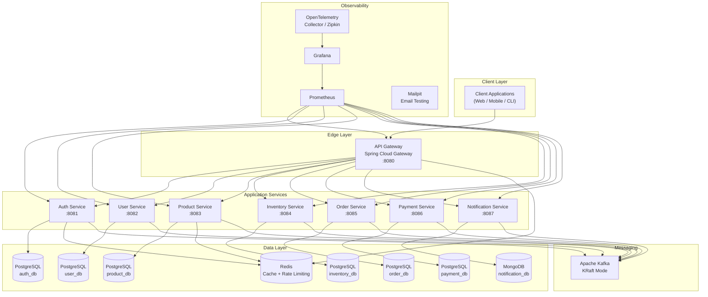
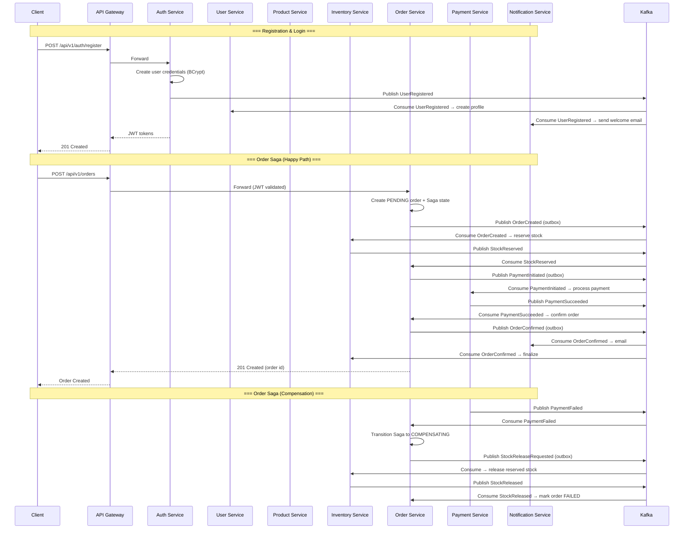
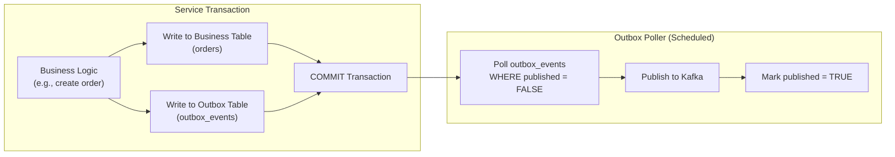
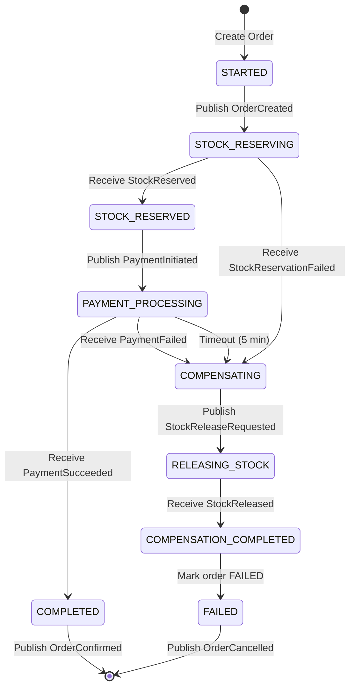
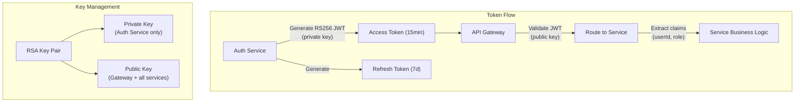
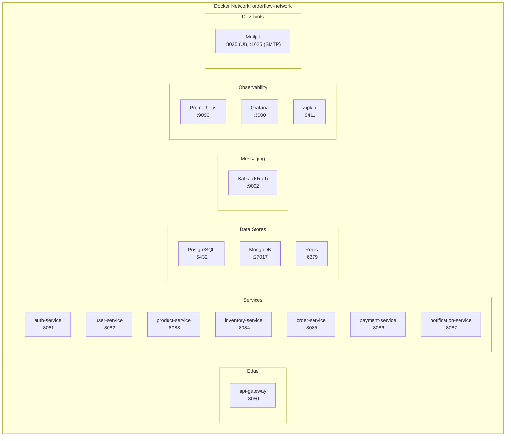
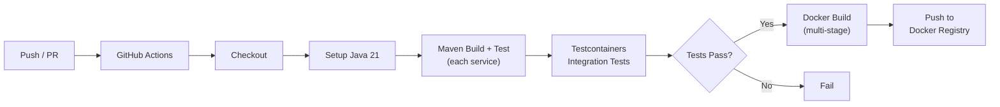
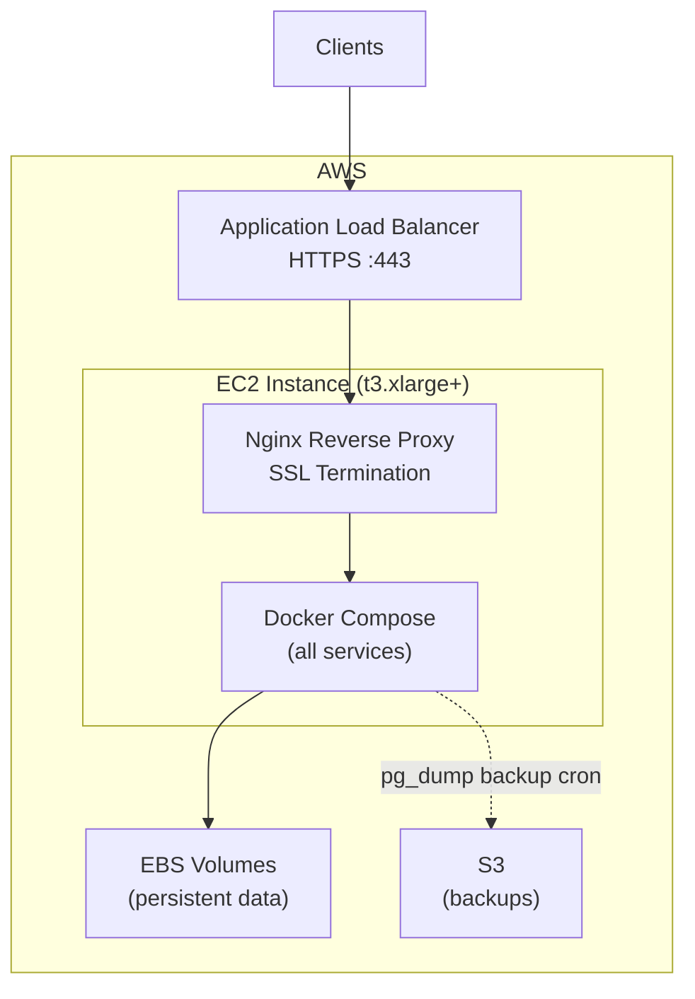

# OrderFlow — E-Commerce Microservices Platform

## Implementation Plan & Architecture Document

---

## 1. Executive Summary

OrderFlow is a production-grade e-commerce microservices platform built entirely with **Java 21 and Spring Boot 3.x**. It comprises **8 Spring Boot services**, communicating via **REST** (synchronous) and **Apache Kafka** (asynchronous), with a **Saga orchestrator** in the Order Service managing distributed transactions across Inventory and Payment.

The platform uses **PostgreSQL** (6 services), **MongoDB** (Notification Service), **Redis** (shared caching/rate-limiting), and is fully **Dockerized** with observability via **Prometheus + Grafana + distributed tracing**.

---

## 2. High-Level Architecture



---

## 3. Service Communication Flow



---

## 4. Service Responsibilities

### 4.1 API Gateway (port 8080)

| Concern | Detail |
|---------|--------|
| **Framework** | Spring Cloud Gateway (reactive) |
| **Database** | None |
| **Responsibilities** | Route requests, JWT token validation (public key), rate limiting (Redis), CORS, correlation ID injection, request logging |
| **Key Dependencies** | `spring-cloud-starter-gateway`, `spring-boot-starter-data-redis-reactive` |

### 4.2 Auth Service (port 8081)

| Concern | Detail |
|---------|--------|
| **Database** | PostgreSQL (`auth_db`) |
| **Tables** | `auth_credentials`, `refresh_tokens` |
| **Responsibilities** | Registration, login, JWT issuance (RS256 asymmetric), refresh token rotation, logout/revocation, RBAC (CUSTOMER, ADMIN) |
| **Publishes** | `UserRegistered` |
| **Caching** | Redis — revoked tokens blacklist, rate limiting data |

### 4.3 User Service (port 8082)

| Concern | Detail |
|---------|--------|
| **Database** | PostgreSQL (`user_db`) |
| **Tables** | `user_profiles`, `addresses` |
| **Responsibilities** | Customer profile CRUD, address management, profile completion |
| **Consumes** | `UserRegistered` (create skeleton profile) |

### 4.4 Product Service (port 8083)

| Concern | Detail |
|---------|--------|
| **Database** | PostgreSQL (`product_db`) |
| **Tables** | `products`, `categories`, `product_categories` |
| **Responsibilities** | Product CRUD, category management, search/filter/sort/paginate, Redis caching with TTL & invalidation |
| **Publishes** | `ProductCreated`, `ProductUpdated` |
| **Caching** | Redis — product detail cache, product listing cache, cache invalidation on writes |

### 4.5 Inventory Service (port 8084)

| Concern | Detail |
|---------|--------|
| **Database** | PostgreSQL (`inventory_db`) |
| **Tables** | `inventory`, `stock_reservations`, `outbox_events` |
| **Responsibilities** | Stock tracking, reservation (optimistic locking), release, concurrent access protection |
| **Consumes** | `OrderCreated` (reserve stock), `OrderCancelled` / `StockReleaseRequested` (release stock), `ProductCreated` (init inventory) |
| **Publishes** | `StockReserved`, `StockReleased`, `StockReservationFailed` |

### 4.6 Order Service (port 8085)

| Concern | Detail |
|---------|--------|
| **Database** | PostgreSQL (`order_db`) |
| **Tables** | `orders`, `order_items`, `saga_instances`, `saga_steps`, `outbox_events` |
| **Responsibilities** | Order creation, order history, cancellation, status tracking, **Saga orchestrator** |
| **Consumes** | `StockReserved`, `StockReservationFailed`, `PaymentSucceeded`, `PaymentFailed`, `StockReleased` |
| **Publishes** | `OrderCreated`, `OrderConfirmed`, `OrderCancelled`, `PaymentInitiated`, `StockReleaseRequested`, `OrderShipped`, `OrderDelivered` |
| **REST Clients** | Calls Product Service (validate products), calls User Service (validate user) |

### 4.7 Payment Service (port 8086)

| Concern | Detail |
|---------|--------|
| **Database** | PostgreSQL (`payment_db`) |
| **Tables** | `payments`, `payment_events`, `refunds`, `outbox_events` |
| **Responsibilities** | Payment initiation, sandbox payment provider simulation, webhook validation (HMAC-SHA256), refund processing, idempotency keys |
| **Consumes** | `PaymentInitiated` |
| **Publishes** | `PaymentSucceeded`, `PaymentFailed`, `RefundCompleted` |

### 4.8 Notification Service (port 8087)

| Concern | Detail |
|---------|--------|
| **Database** | MongoDB (`notification_db`) |
| **Collections** | `notifications`, `notification_templates` |
| **Responsibilities** | Email dispatch (via Mailpit SMTP), notification history, template rendering, delivery tracking |
| **Consumes** | `UserRegistered`, `OrderConfirmed`, `OrderCancelled`, `PaymentSucceeded`, `PaymentFailed`, `RefundCompleted`, `OrderShipped`, `OrderDelivered` |

---

## 5. Database Schema Design

### 5.1 Auth Service — PostgreSQL (`auth_db`)

```sql
-- V1__init_auth_schema.sql
CREATE TABLE auth_credentials (
    id              UUID PRIMARY KEY DEFAULT gen_random_uuid(),
    email           VARCHAR(255) NOT NULL UNIQUE,
    password_hash   VARCHAR(255) NOT NULL,
    role            VARCHAR(20) NOT NULL DEFAULT 'CUSTOMER',  -- CUSTOMER | ADMIN
    is_enabled      BOOLEAN NOT NULL DEFAULT TRUE,
    is_locked       BOOLEAN NOT NULL DEFAULT FALSE,
    failed_attempts INT NOT NULL DEFAULT 0,
    locked_until    TIMESTAMP,
    created_at      TIMESTAMP NOT NULL DEFAULT NOW(),
    updated_at      TIMESTAMP NOT NULL DEFAULT NOW()
);

CREATE TABLE refresh_tokens (
    id              UUID PRIMARY KEY DEFAULT gen_random_uuid(),
    user_id         UUID NOT NULL REFERENCES auth_credentials(id),
    token_hash      VARCHAR(255) NOT NULL UNIQUE,
    family_id       UUID NOT NULL,     -- for rotation detection
    expires_at      TIMESTAMP NOT NULL,
    revoked         BOOLEAN NOT NULL DEFAULT FALSE,
    revoked_at      TIMESTAMP,
    replaced_by     UUID,              -- points to next token in rotation
    created_at      TIMESTAMP NOT NULL DEFAULT NOW()
);

CREATE INDEX idx_refresh_tokens_user_id ON refresh_tokens(user_id);
CREATE INDEX idx_refresh_tokens_family_id ON refresh_tokens(family_id);
```

### 5.2 User Service — PostgreSQL (`user_db`)

```sql
-- V1__init_user_schema.sql
CREATE TABLE user_profiles (
    id              UUID PRIMARY KEY DEFAULT gen_random_uuid(),
    auth_user_id    UUID NOT NULL UNIQUE,   -- maps to auth_credentials.id
    email           VARCHAR(255) NOT NULL,
    first_name      VARCHAR(100),
    last_name       VARCHAR(100),
    phone_number    VARCHAR(20),
    date_of_birth   DATE,
    avatar_url      VARCHAR(500),
    created_at      TIMESTAMP NOT NULL DEFAULT NOW(),
    updated_at      TIMESTAMP NOT NULL DEFAULT NOW()
);

CREATE TABLE addresses (
    id              UUID PRIMARY KEY DEFAULT gen_random_uuid(),
    user_id         UUID NOT NULL REFERENCES user_profiles(id),
    label           VARCHAR(50) NOT NULL DEFAULT 'HOME',  -- HOME | WORK | OTHER
    street_line1    VARCHAR(255) NOT NULL,
    street_line2    VARCHAR(255),
    city            VARCHAR(100) NOT NULL,
    state           VARCHAR(100) NOT NULL,
    postal_code     VARCHAR(20) NOT NULL,
    country         VARCHAR(100) NOT NULL,
    is_default      BOOLEAN NOT NULL DEFAULT FALSE,
    created_at      TIMESTAMP NOT NULL DEFAULT NOW(),
    updated_at      TIMESTAMP NOT NULL DEFAULT NOW()
);

CREATE INDEX idx_addresses_user_id ON addresses(user_id);
```

### 5.3 Product Service — PostgreSQL (`product_db`)

```sql
-- V1__init_product_schema.sql
CREATE TABLE categories (
    id              UUID PRIMARY KEY DEFAULT gen_random_uuid(),
    name            VARCHAR(100) NOT NULL UNIQUE,
    slug            VARCHAR(100) NOT NULL UNIQUE,
    description     TEXT,
    parent_id       UUID REFERENCES categories(id),
    display_order   INT NOT NULL DEFAULT 0,
    is_active       BOOLEAN NOT NULL DEFAULT TRUE,
    created_at      TIMESTAMP NOT NULL DEFAULT NOW(),
    updated_at      TIMESTAMP NOT NULL DEFAULT NOW()
);

CREATE TABLE products (
    id              UUID PRIMARY KEY DEFAULT gen_random_uuid(),
    name            VARCHAR(255) NOT NULL,
    slug            VARCHAR(255) NOT NULL UNIQUE,
    description     TEXT,
    short_description VARCHAR(500),
    price           DECIMAL(12,2) NOT NULL,
    compare_at_price DECIMAL(12,2),
    sku             VARCHAR(50) NOT NULL UNIQUE,
    image_url       VARCHAR(500),
    is_active       BOOLEAN NOT NULL DEFAULT TRUE,
    weight          DECIMAL(8,2),
    brand           VARCHAR(100),
    created_at      TIMESTAMP NOT NULL DEFAULT NOW(),
    updated_at      TIMESTAMP NOT NULL DEFAULT NOW()
);

CREATE TABLE product_categories (
    product_id      UUID NOT NULL REFERENCES products(id) ON DELETE CASCADE,
    category_id     UUID NOT NULL REFERENCES categories(id) ON DELETE CASCADE,
    PRIMARY KEY (product_id, category_id)
);

CREATE INDEX idx_products_sku ON products(sku);
CREATE INDEX idx_products_name ON products(name);
CREATE INDEX idx_products_is_active ON products(is_active);
```

### 5.4 Inventory Service — PostgreSQL (`inventory_db`)

```sql
-- V1__init_inventory_schema.sql
CREATE TABLE inventory (
    id              UUID PRIMARY KEY DEFAULT gen_random_uuid(),
    product_id      UUID NOT NULL UNIQUE,
    sku             VARCHAR(50) NOT NULL UNIQUE,
    total_quantity  INT NOT NULL DEFAULT 0,
    reserved_quantity INT NOT NULL DEFAULT 0,
    version         BIGINT NOT NULL DEFAULT 0,    -- optimistic locking
    reorder_level   INT NOT NULL DEFAULT 10,
    created_at      TIMESTAMP NOT NULL DEFAULT NOW(),
    updated_at      TIMESTAMP NOT NULL DEFAULT NOW(),
    CONSTRAINT chk_quantity CHECK (total_quantity >= 0),
    CONSTRAINT chk_reserved CHECK (reserved_quantity >= 0),
    CONSTRAINT chk_available CHECK (total_quantity >= reserved_quantity)
);

CREATE TABLE stock_reservations (
    id              UUID PRIMARY KEY DEFAULT gen_random_uuid(),
    order_id        UUID NOT NULL,
    product_id      UUID NOT NULL,
    quantity         INT NOT NULL,
    status          VARCHAR(20) NOT NULL DEFAULT 'RESERVED',  -- RESERVED | CONFIRMED | RELEASED
    expires_at      TIMESTAMP NOT NULL,
    created_at      TIMESTAMP NOT NULL DEFAULT NOW(),
    updated_at      TIMESTAMP NOT NULL DEFAULT NOW()
);

CREATE TABLE outbox_events (
    id              UUID PRIMARY KEY DEFAULT gen_random_uuid(),
    aggregate_type  VARCHAR(100) NOT NULL,
    aggregate_id    UUID NOT NULL,
    event_type      VARCHAR(100) NOT NULL,
    payload         JSONB NOT NULL,
    correlation_id  VARCHAR(100),
    published       BOOLEAN NOT NULL DEFAULT FALSE,
    published_at    TIMESTAMP,
    created_at      TIMESTAMP NOT NULL DEFAULT NOW()
);

CREATE INDEX idx_stock_reservations_order_id ON stock_reservations(order_id);
CREATE INDEX idx_outbox_unpublished ON outbox_events(published, created_at) WHERE published = FALSE;
```

### 5.5 Order Service — PostgreSQL (`order_db`)

```sql
-- V1__init_order_schema.sql
CREATE TABLE orders (
    id              UUID PRIMARY KEY DEFAULT gen_random_uuid(),
    user_id         UUID NOT NULL,
    order_number    VARCHAR(30) NOT NULL UNIQUE,
    status          VARCHAR(30) NOT NULL DEFAULT 'PENDING',
    -- PENDING → INVENTORY_RESERVED → PAYMENT_PROCESSING → CONFIRMED → SHIPPED → DELIVERED
    -- PENDING → FAILED | CANCELLED
    subtotal        DECIMAL(12,2) NOT NULL,
    tax_amount      DECIMAL(12,2) NOT NULL DEFAULT 0,
    total_amount    DECIMAL(12,2) NOT NULL,
    shipping_address_id UUID,
    shipping_address_snapshot JSONB,
    notes           TEXT,
    cancelled_reason TEXT,
    created_at      TIMESTAMP NOT NULL DEFAULT NOW(),
    updated_at      TIMESTAMP NOT NULL DEFAULT NOW()
);

CREATE TABLE order_items (
    id              UUID PRIMARY KEY DEFAULT gen_random_uuid(),
    order_id        UUID NOT NULL REFERENCES orders(id),
    product_id      UUID NOT NULL,
    product_name    VARCHAR(255) NOT NULL,   -- snapshot at order time
    sku             VARCHAR(50) NOT NULL,
    quantity        INT NOT NULL,
    unit_price      DECIMAL(12,2) NOT NULL,  -- snapshot at order time
    total_price     DECIMAL(12,2) NOT NULL,
    created_at      TIMESTAMP NOT NULL DEFAULT NOW()
);

CREATE TABLE saga_instances (
    id              UUID PRIMARY KEY DEFAULT gen_random_uuid(),
    order_id        UUID NOT NULL UNIQUE REFERENCES orders(id),
    saga_type       VARCHAR(50) NOT NULL DEFAULT 'ORDER_CREATION',
    current_step    VARCHAR(50) NOT NULL,
    status          VARCHAR(30) NOT NULL DEFAULT 'STARTED',
    -- STARTED | STOCK_RESERVING | STOCK_RESERVED | PAYMENT_PROCESSING
    -- | COMPLETED | COMPENSATING | COMPENSATION_COMPLETED | FAILED
    payload         JSONB,
    retry_count     INT NOT NULL DEFAULT 0,
    max_retries     INT NOT NULL DEFAULT 3,
    timeout_at      TIMESTAMP,
    created_at      TIMESTAMP NOT NULL DEFAULT NOW(),
    updated_at      TIMESTAMP NOT NULL DEFAULT NOW()
);

CREATE TABLE saga_steps (
    id              UUID PRIMARY KEY DEFAULT gen_random_uuid(),
    saga_id         UUID NOT NULL REFERENCES saga_instances(id),
    step_name       VARCHAR(50) NOT NULL,
    status          VARCHAR(20) NOT NULL DEFAULT 'PENDING',
    -- PENDING | IN_PROGRESS | COMPLETED | COMPENSATING | COMPENSATED | FAILED
    request_payload JSONB,
    response_payload JSONB,
    compensation_payload JSONB,
    error_message   TEXT,
    started_at      TIMESTAMP,
    completed_at    TIMESTAMP,
    created_at      TIMESTAMP NOT NULL DEFAULT NOW()
);

CREATE TABLE outbox_events (
    id              UUID PRIMARY KEY DEFAULT gen_random_uuid(),
    aggregate_type  VARCHAR(100) NOT NULL,
    aggregate_id    UUID NOT NULL,
    event_type      VARCHAR(100) NOT NULL,
    payload         JSONB NOT NULL,
    correlation_id  VARCHAR(100),
    published       BOOLEAN NOT NULL DEFAULT FALSE,
    published_at    TIMESTAMP,
    created_at      TIMESTAMP NOT NULL DEFAULT NOW()
);

CREATE INDEX idx_orders_user_id ON orders(user_id);
CREATE INDEX idx_orders_status ON orders(status);
CREATE INDEX idx_order_items_order_id ON order_items(order_id);
CREATE INDEX idx_saga_instances_status ON saga_instances(status);
CREATE INDEX idx_outbox_unpublished ON outbox_events(published, created_at) WHERE published = FALSE;
```

### 5.6 Payment Service — PostgreSQL (`payment_db`)

```sql
-- V1__init_payment_schema.sql
CREATE TABLE payments (
    id                  UUID PRIMARY KEY DEFAULT gen_random_uuid(),
    order_id            UUID NOT NULL,
    user_id             UUID NOT NULL,
    idempotency_key     VARCHAR(100) NOT NULL UNIQUE,
    amount              DECIMAL(12,2) NOT NULL,
    currency            VARCHAR(3) NOT NULL DEFAULT 'USD',
    status              VARCHAR(30) NOT NULL DEFAULT 'PENDING',
    -- PENDING → PROCESSING → SUCCEEDED → REFUNDED (partial/full)
    -- PENDING → FAILED
    provider            VARCHAR(50) NOT NULL DEFAULT 'SANDBOX',
    provider_payment_id VARCHAR(255),
    provider_response   JSONB,
    failure_reason      TEXT,
    paid_at             TIMESTAMP,
    created_at          TIMESTAMP NOT NULL DEFAULT NOW(),
    updated_at          TIMESTAMP NOT NULL DEFAULT NOW()
);

CREATE TABLE payment_events (
    id              UUID PRIMARY KEY DEFAULT gen_random_uuid(),
    payment_id      UUID NOT NULL REFERENCES payments(id),
    event_type      VARCHAR(50) NOT NULL,
    event_data      JSONB,
    webhook_signature VARCHAR(255),
    webhook_verified BOOLEAN DEFAULT FALSE,
    created_at      TIMESTAMP NOT NULL DEFAULT NOW()
);

CREATE TABLE refunds (
    id              UUID PRIMARY KEY DEFAULT gen_random_uuid(),
    payment_id      UUID NOT NULL REFERENCES payments(id),
    idempotency_key VARCHAR(100) NOT NULL UNIQUE,
    amount          DECIMAL(12,2) NOT NULL,
    reason          TEXT,
    status          VARCHAR(20) NOT NULL DEFAULT 'PENDING', -- PENDING → COMPLETED → FAILED
    provider_refund_id VARCHAR(255),
    created_at      TIMESTAMP NOT NULL DEFAULT NOW(),
    updated_at      TIMESTAMP NOT NULL DEFAULT NOW()
);

CREATE TABLE outbox_events (
    id              UUID PRIMARY KEY DEFAULT gen_random_uuid(),
    aggregate_type  VARCHAR(100) NOT NULL,
    aggregate_id    UUID NOT NULL,
    event_type      VARCHAR(100) NOT NULL,
    payload         JSONB NOT NULL,
    correlation_id  VARCHAR(100),
    published       BOOLEAN NOT NULL DEFAULT FALSE,
    published_at    TIMESTAMP,
    created_at      TIMESTAMP NOT NULL DEFAULT NOW()
);

CREATE INDEX idx_payments_order_id ON payments(order_id);
CREATE INDEX idx_payments_idempotency ON payments(idempotency_key);
CREATE INDEX idx_refunds_payment_id ON refunds(payment_id);
CREATE INDEX idx_outbox_unpublished ON outbox_events(published, created_at) WHERE published = FALSE;
```

### 5.7 Notification Service — MongoDB (`notification_db`)

```javascript
// notifications collection (flexible document schema)
{
  _id: ObjectId,
  notificationId: UUID,
  userId: UUID,
  type: "EMAIL",                        // EMAIL | SMS | PUSH (extensible)
  channel: "email",
  templateName: "order_confirmed",
  subject: "Your order #ORD-20261113-001 is confirmed!",
  recipientEmail: "user@example.com",
  body: "<html>...</html>",
  status: "SENT",                       // PENDING | SENT | FAILED | RETRYING
  retryCount: 0,
  maxRetries: 3,
  errorMessage: null,
  metadata: {
    orderId: UUID,
    orderNumber: "ORD-20261113-001",
    correlationId: "corr-xyz-123"
  },
  sentAt: ISODate,
  createdAt: ISODate,
  updatedAt: ISODate
}

// notification_templates collection
{
  _id: ObjectId,
  templateName: "order_confirmed",      // unique
  subject: "Your order {{orderNumber}} is confirmed!",
  bodyTemplate: "<html>...<b>{{customerName}}</b>...</html>",
  channel: "email",
  isActive: true,
  createdAt: ISODate,
  updatedAt: ISODate
}
```

---

## 6. REST API Contracts

### 6.1 Standard Response Envelope

```json
{
  "success": true,
  "message": "Operation completed successfully",
  "data": { },
  "errors": null,
  "timestamp": "2026-11-13T08:00:00Z",
  "path": "/api/v1/products",
  "correlationId": "corr-abc-123"
}
```

For paginated responses:
```json
{
  "success": true,
  "data": {
    "content": [ ],
    "pageNumber": 0,
    "pageSize": 20,
    "totalElements": 150,
    "totalPages": 8,
    "last": false
  }
}
```

### 6.2 Auth Service APIs

| Method | Endpoint | Auth | Description |
|--------|----------|------|-------------|
| `POST` | `/api/v1/auth/register` | Public | Register new customer |
| `POST` | `/api/v1/auth/login` | Public | Login → JWT access + refresh tokens |
| `POST` | `/api/v1/auth/refresh` | Public (refresh token) | Rotate refresh token |
| `POST` | `/api/v1/auth/logout` | Authenticated | Revoke refresh token family |
| `GET`  | `/api/v1/auth/me` | Authenticated | Get current user auth info |
| `POST` | `/api/v1/auth/admin/users` | ADMIN | Create admin user |

### 6.3 User Service APIs

| Method | Endpoint | Auth | Description |
|--------|----------|------|-------------|
| `GET`    | `/api/v1/users/me` | Authenticated | Get own profile |
| `PUT`    | `/api/v1/users/me` | Authenticated | Update own profile |
| `GET`    | `/api/v1/users/me/addresses` | Authenticated | List addresses |
| `POST`   | `/api/v1/users/me/addresses` | Authenticated | Add address |
| `PUT`    | `/api/v1/users/me/addresses/{id}` | Authenticated | Update address |
| `DELETE` | `/api/v1/users/me/addresses/{id}` | Authenticated | Delete address |
| `GET`    | `/api/v1/admin/users` | ADMIN | List all users (paginated) |
| `GET`    | `/api/v1/admin/users/{id}` | ADMIN | Get user by ID |

### 6.4 Product Service APIs

| Method | Endpoint | Auth | Description |
|--------|----------|------|-------------|
| `GET`    | `/api/v1/products` | Public | List products (search, filter, sort, paginate) |
| `GET`    | `/api/v1/products/{id}` | Public | Get product by ID |
| `GET`    | `/api/v1/products/slug/{slug}` | Public | Get product by slug |
| `POST`   | `/api/v1/admin/products` | ADMIN | Create product |
| `PUT`    | `/api/v1/admin/products/{id}` | ADMIN | Update product |
| `DELETE` | `/api/v1/admin/products/{id}` | ADMIN | Soft-delete product |
| `GET`    | `/api/v1/categories` | Public | List categories |
| `POST`   | `/api/v1/admin/categories` | ADMIN | Create category |
| `PUT`    | `/api/v1/admin/categories/{id}` | ADMIN | Update category |

**Query parameters for `GET /products`**: `?search=keyword&categoryId=uuid&minPrice=10&maxPrice=100&brand=Nike&sortBy=price&sortDir=asc&page=0&size=20`

### 6.5 Inventory Service APIs

| Method | Endpoint | Auth | Description |
|--------|----------|------|-------------|
| `GET`  | `/api/v1/inventory/{productId}` | Public | Check stock availability |
| `GET`  | `/api/v1/inventory/batch` | Internal/Public | Batch stock check (query param: `productIds`) |
| `PUT`  | `/api/v1/admin/inventory/{productId}` | ADMIN | Update stock quantity |
| `POST` | `/api/v1/admin/inventory` | ADMIN | Initialize inventory for product |

> [!NOTE]
> Stock reservation and release happen exclusively via Kafka events. No REST endpoints for reservation — this prevents bypassing the Saga.

### 6.6 Order Service APIs

| Method | Endpoint | Auth | Description |
|--------|----------|------|-------------|
| `POST`   | `/api/v1/orders` | CUSTOMER | Create order |
| `GET`    | `/api/v1/orders` | CUSTOMER | List own orders (paginated) |
| `GET`    | `/api/v1/orders/{id}` | CUSTOMER (owner) | Get order details |
| `POST`   | `/api/v1/orders/{id}/cancel` | CUSTOMER (owner) | Cancel order |
| `GET`    | `/api/v1/admin/orders` | ADMIN | List all orders (paginated, filtered) |
| `PUT`    | `/api/v1/admin/orders/{id}/status` | ADMIN | Update order status (ship, deliver) |

### 6.7 Payment Service APIs

| Method | Endpoint | Auth | Description |
|--------|----------|------|-------------|
| `GET`   | `/api/v1/payments/order/{orderId}` | Authenticated (owner) | Get payment for order |
| `POST`  | `/api/v1/payments/webhook` | Webhook (HMAC signed) | Sandbox webhook callback |
| `POST`  | `/api/v1/admin/payments/{id}/refund` | ADMIN | Initiate refund |
| `GET`   | `/api/v1/admin/payments` | ADMIN | List payments (paginated) |

> [!NOTE]
> Payment initiation is triggered by Kafka `PaymentInitiated` event from the Saga, not by a REST endpoint. This ensures payments only happen as part of a valid order flow.

### 6.8 Notification Service APIs

| Method | Endpoint | Auth | Description |
|--------|----------|------|-------------|
| `GET`  | `/api/v1/notifications` | Authenticated | List own notification history (paginated) |
| `GET`  | `/api/v1/notifications/{id}` | Authenticated (owner) | Get notification detail |
| `GET`  | `/api/v1/admin/notifications` | ADMIN | List all notifications |

---

## 7. Kafka Event Schemas & Topics

### 7.1 Topic Configuration

| Topic | Partitions | Replication | Retention | Producer | Consumer(s) |
|-------|-----------|-------------|-----------|----------|-------------|
| `orderflow.auth.user-registered` | 3 | 1 (dev) | 7d | Auth | User, Notification |
| `orderflow.product.product-created` | 3 | 1 | 7d | Product | Inventory |
| `orderflow.product.product-updated` | 3 | 1 | 7d | Product | Inventory |
| `orderflow.order.order-created` | 6 | 1 | 7d | Order | Inventory |
| `orderflow.order.order-confirmed` | 6 | 1 | 7d | Order | Notification, Inventory |
| `orderflow.order.order-cancelled` | 6 | 1 | 7d | Order | Notification, Inventory |
| `orderflow.order.payment-initiated` | 6 | 1 | 7d | Order | Payment |
| `orderflow.order.stock-release-requested` | 6 | 1 | 7d | Order | Inventory |
| `orderflow.order.order-shipped` | 3 | 1 | 7d | Order | Notification |
| `orderflow.order.order-delivered` | 3 | 1 | 7d | Order | Notification |
| `orderflow.inventory.stock-reserved` | 6 | 1 | 7d | Inventory | Order |
| `orderflow.inventory.stock-reservation-failed` | 3 | 1 | 7d | Inventory | Order |
| `orderflow.inventory.stock-released` | 6 | 1 | 7d | Inventory | Order |
| `orderflow.payment.payment-succeeded` | 6 | 1 | 7d | Payment | Order, Notification |
| `orderflow.payment.payment-failed` | 3 | 1 | 7d | Payment | Order, Notification |
| `orderflow.payment.refund-completed` | 3 | 1 | 7d | Payment | Order, Notification |
| `orderflow.*.dlq` | 1 | 1 | 30d | All | Monitoring/manual retry |

### 7.2 Base Event Envelope

```java
public abstract class BaseEvent {
    private String eventId;          // UUID — globally unique
    private String eventType;        // e.g., "OrderCreated"
    private String aggregateId;      // e.g., order UUID
    private String aggregateType;    // e.g., "Order"
    private Instant timestamp;
    private int version;             // schema version (1, 2, ...)
    private String correlationId;    // trace across services
    private String source;           // e.g., "order-service"
}
```

### 7.3 Key Event Payloads

```java
// OrderCreated payload
{
  "orderId": "uuid",
  "userId": "uuid",
  "orderNumber": "ORD-20261113-001",
  "items": [
    { "productId": "uuid", "sku": "SKU-001", "quantity": 2, "unitPrice": 29.99 }
  ],
  "totalAmount": 59.98
}

// StockReserved payload
{
  "orderId": "uuid",
  "reservations": [
    { "productId": "uuid", "reservationId": "uuid", "quantity": 2 }
  ]
}

// PaymentInitiated payload
{
  "orderId": "uuid",
  "userId": "uuid",
  "amount": 59.98,
  "currency": "USD",
  "idempotencyKey": "pay-uuid-order-uuid"
}

// PaymentSucceeded payload
{
  "paymentId": "uuid",
  "orderId": "uuid",
  "amount": 59.98,
  "providerPaymentId": "sandbox-txn-123"
}
```

### 7.4 Transactional Outbox Pattern



- Each service that publishes events has an `outbox_events` table
- Business writes and outbox inserts happen in the **same database transaction**
- A `@Scheduled` poller (every 500ms) reads unpublished events and publishes to Kafka
- After successful Kafka send, marks the event as published
- This guarantees **at-least-once** delivery (consumers must be idempotent)

### 7.5 Idempotent Consumer Pattern

```java
// Each consumer service maintains a processed_events table or set
CREATE TABLE processed_events (
    event_id    VARCHAR(100) PRIMARY KEY,
    processed_at TIMESTAMP NOT NULL DEFAULT NOW()
);

// Before processing:
// 1. Check if event_id exists in processed_events
// 2. If yes → skip (duplicate)
// 3. If no → process + insert event_id in same transaction
```

---

## 8. Saga Orchestration Design



**Saga States:**

| State | Description | Next Event |
|-------|-------------|------------|
| `STARTED` | Order and saga created | Publish `OrderCreated` |
| `STOCK_RESERVING` | Waiting for inventory reservation | `StockReserved` or `StockReservationFailed` |
| `STOCK_RESERVED` | Inventory reserved | Publish `PaymentInitiated` |
| `PAYMENT_PROCESSING` | Waiting for payment result | `PaymentSucceeded` or `PaymentFailed` or timeout |
| `COMPLETED` | Payment succeeded, order confirmed | Publish `OrderConfirmed` |
| `COMPENSATING` | Compensation in progress | Publish `StockReleaseRequested` |
| `RELEASING_STOCK` | Waiting for stock release | `StockReleased` |
| `COMPENSATION_COMPLETED` | All compensations done | Mark order `FAILED` |
| `FAILED` | Terminal failure state | Publish `OrderCancelled` |

**Timeout handling**: A `@Scheduled` task polls for Sagas stuck in `PAYMENT_PROCESSING` beyond 5 minutes and triggers compensation.

---

## 9. Security Architecture



**Key Design Decisions:**

- **Asymmetric JWT (RS256)**: Auth Service holds the private key and signs tokens. All other services and the Gateway only need the public key to validate tokens — no shared secrets.
- **Access token**: 15-minute expiry, contains `userId`, `email`, `role`, issued at, expiry.
- **Refresh token**: 7-day expiry, stored hashed in DB. Rotation on every use with **family-based revocation** (if a stolen refresh token is reused, the entire family is revoked).
- **Token blacklist**: On logout, the access token's `jti` is added to a Redis blacklist with TTL equal to remaining token lifetime. The Gateway checks this blacklist.
- **IDOR prevention**: Every `@PreAuthorize` or service-layer check ensures users can only access their own resources. Admin bypasses this.
- **Rate limiting**: Redis-based sliding window rate limiter on the API Gateway (e.g., 100 requests/minute per IP for public endpoints, 1000/minute for authenticated).

---

## 10. Caching Strategy (Redis)

| Service | Key Pattern | TTL | Invalidation |
|---------|------------|-----|--------------|
| API Gateway | `ratelimit:{ip}:{endpoint}` | 1 min window | Auto-expire |
| Auth Service | `auth:blacklist:{jti}` | Remaining token TTL | Auto-expire |
| Auth Service | `auth:ratelimit:login:{ip}` | 15 min | Auto-expire |
| Product Service | `product:detail:{productId}` | 30 min | Invalidate on update/delete |
| Product Service | `product:list:{hash(queryParams)}` | 10 min | Invalidate on any product mutation |
| Product Service | `product:categories:all` | 1 hour | Invalidate on category mutation |

**Redis logical database separation** (or key namespace prefixes):
- DB 0 / prefix `gw:` — Gateway rate limiting
- DB 1 / prefix `auth:` — Auth token blacklist, login rate limiting
- DB 2 / prefix `product:` — Product cache

---

## 11. Complete Monorepo Folder Structure

```
OrderFlow/
├── .github/
│   └── workflows/
│       ├── ci.yml                        # Build + test all services
│       └── docker-publish.yml            # Build + push Docker images
├── docs/
│   ├── architecture.md
│   ├── api-contracts.md
│   ├── kafka-events.md
│   └── deployment-guide.md
├── docker-compose.yml
├── .env.example
├── .dockerignore
├── .gitignore
├── README.md
│
├── api-gateway/
│   ├── Dockerfile
│   ├── pom.xml
│   ├── README.md
│   └── src/
│       ├── main/
│       │   ├── java/com/orderflow/gateway/
│       │   │   ├── config/
│       │   │   │   ├── GatewayConfig.java
│       │   │   │   ├── CorsConfig.java
│       │   │   │   ├── RateLimitConfig.java
│       │   │   │   └── SecurityConfig.java
│       │   │   ├── filter/
│       │   │   │   ├── JwtAuthenticationFilter.java
│       │   │   │   ├── CorrelationIdFilter.java
│       │   │   │   ├── RateLimitFilter.java
│       │   │   │   └── RequestLoggingFilter.java
│       │   │   ├── exception/
│       │   │   │   └── GatewayExceptionHandler.java
│       │   │   ├── security/
│       │   │   │   └── JwtTokenValidator.java
│       │   │   ├── util/
│       │   │   │   └── JwtUtil.java
│       │   │   └── ApiGatewayApplication.java
│       │   └── resources/
│       │       ├── application.yml
│       │       ├── application-dev.yml
│       │       └── application-prod.yml
│       └── test/java/
│           ├── unit/
│           └── integration/
│
├── auth-service/
│   ├── Dockerfile
│   ├── pom.xml
│   ├── README.md
│   └── src/
│       ├── main/
│       │   ├── java/com/orderflow/auth/
│       │   │   ├── config/
│       │   │   │   ├── SecurityConfig.java
│       │   │   │   ├── JwtConfig.java
│       │   │   │   ├── RedisConfig.java
│       │   │   │   └── KafkaProducerConfig.java
│       │   │   ├── controller/
│       │   │   │   └── AuthController.java
│       │   │   ├── dto/
│       │   │   │   ├── request/
│       │   │   │   │   ├── RegisterRequest.java
│       │   │   │   │   ├── LoginRequest.java
│       │   │   │   │   └── RefreshTokenRequest.java
│       │   │   │   └── response/
│       │   │   │       ├── AuthResponse.java
│       │   │   │       └── UserInfoResponse.java
│       │   │   ├── entity/
│       │   │   │   ├── AuthCredential.java
│       │   │   │   └── RefreshToken.java
│       │   │   ├── enums/
│       │   │   │   └── Role.java
│       │   │   ├── exception/
│       │   │   │   ├── AuthException.java
│       │   │   │   ├── TokenExpiredException.java
│       │   │   │   └── GlobalExceptionHandler.java
│       │   │   ├── mapper/
│       │   │   │   └── AuthMapper.java
│       │   │   ├── repository/
│       │   │   │   ├── AuthCredentialRepository.java
│       │   │   │   └── RefreshTokenRepository.java
│       │   │   ├── service/
│       │   │   │   ├── AuthService.java
│       │   │   │   └── impl/
│       │   │   │       └── AuthServiceImpl.java
│       │   │   ├── messaging/
│       │   │   │   ├── producer/
│       │   │   │   │   └── AuthEventProducer.java
│       │   │   │   └── event/
│       │   │   │       └── UserRegisteredEvent.java
│       │   │   ├── security/
│       │   │   │   ├── JwtTokenProvider.java
│       │   │   │   └── CustomUserDetailsService.java
│       │   │   ├── validation/
│       │   │   │   └── PasswordValidator.java
│       │   │   ├── util/
│       │   │   │   └── KeyPairUtil.java
│       │   │   ├── constant/
│       │   │   │   └── AuthConstants.java
│       │   │   └── AuthServiceApplication.java
│       │   └── resources/
│       │       ├── application.yml
│       │       ├── application-dev.yml
│       │       ├── application-prod.yml
│       │       ├── keys/               # RSA key pair (dev only, prod uses env)
│       │       └── db/migration/
│       │           └── V1__init_auth_schema.sql
│       └── test/java/
│           ├── unit/
│           └── integration/
│
├── user-service/
│   ├── Dockerfile
│   ├── pom.xml
│   ├── README.md
│   └── src/
│       ├── main/
│       │   ├── java/com/orderflow/user/
│       │   │   ├── config/
│       │   │   ├── controller/
│       │   │   │   ├── UserController.java
│       │   │   │   └── AddressController.java
│       │   │   ├── dto/
│       │   │   │   ├── request/
│       │   │   │   └── response/
│       │   │   ├── entity/
│       │   │   │   ├── UserProfile.java
│       │   │   │   └── Address.java
│       │   │   ├── enums/
│       │   │   │   └── AddressLabel.java
│       │   │   ├── exception/
│       │   │   ├── mapper/
│       │   │   ├── repository/
│       │   │   ├── service/
│       │   │   │   ├── UserService.java
│       │   │   │   └── impl/
│       │   │   ├── messaging/
│       │   │   │   ├── consumer/
│       │   │   │   │   └── UserRegisteredConsumer.java
│       │   │   │   └── event/
│       │   │   ├── security/
│       │   │   ├── validation/
│       │   │   └── UserServiceApplication.java
│       │   └── resources/
│       │       ├── application.yml
│       │       └── db/migration/
│       │           └── V1__init_user_schema.sql
│       └── test/java/
│
├── product-service/
│   ├── Dockerfile
│   ├── pom.xml
│   ├── README.md
│   └── src/
│       ├── main/
│       │   ├── java/com/orderflow/product/
│       │   │   ├── config/
│       │   │   │   ├── RedisConfig.java
│       │   │   │   └── KafkaProducerConfig.java
│       │   │   ├── controller/
│       │   │   │   ├── ProductController.java
│       │   │   │   ├── CategoryController.java
│       │   │   │   └── AdminProductController.java
│       │   │   ├── dto/
│       │   │   ├── entity/
│       │   │   │   ├── Product.java
│       │   │   │   ├── Category.java
│       │   │   │   └── ProductCategory.java
│       │   │   ├── enums/
│       │   │   ├── exception/
│       │   │   ├── mapper/
│       │   │   ├── repository/
│       │   │   │   ├── ProductRepository.java
│       │   │   │   └── CategoryRepository.java
│       │   │   ├── service/
│       │   │   │   ├── ProductService.java
│       │   │   │   ├── CategoryService.java
│       │   │   │   └── impl/
│       │   │   │       ├── ProductServiceImpl.java
│       │   │   │       └── CategoryServiceImpl.java
│       │   │   ├── messaging/
│       │   │   │   ├── producer/
│       │   │   │   └── event/
│       │   │   ├── security/
│       │   │   └── ProductServiceApplication.java
│       │   └── resources/
│       │       ├── application.yml
│       │       └── db/migration/
│       │           └── V1__init_product_schema.sql
│       └── test/java/
│
├── inventory-service/
│   ├── Dockerfile
│   ├── pom.xml
│   ├── README.md
│   └── src/
│       ├── main/
│       │   ├── java/com/orderflow/inventory/
│       │   │   ├── config/
│       │   │   ├── controller/
│       │   │   │   └── InventoryController.java
│       │   │   ├── dto/
│       │   │   ├── entity/
│       │   │   │   ├── Inventory.java
│       │   │   │   ├── StockReservation.java
│       │   │   │   └── OutboxEvent.java
│       │   │   ├── enums/
│       │   │   │   └── ReservationStatus.java
│       │   │   ├── exception/
│       │   │   │   └── InsufficientStockException.java
│       │   │   ├── mapper/
│       │   │   ├── repository/
│       │   │   ├── service/
│       │   │   │   ├── InventoryService.java
│       │   │   │   └── impl/
│       │   │   │       └── InventoryServiceImpl.java
│       │   │   ├── messaging/
│       │   │   │   ├── producer/
│       │   │   │   │   └── InventoryEventProducer.java
│       │   │   │   ├── consumer/
│       │   │   │   │   ├── OrderCreatedConsumer.java
│       │   │   │   │   ├── StockReleaseConsumer.java
│       │   │   │   │   └── ProductCreatedConsumer.java
│       │   │   │   └── event/
│       │   │   ├── scheduler/
│       │   │   │   └── OutboxPollerScheduler.java
│       │   │   └── InventoryServiceApplication.java
│       │   └── resources/
│       │       ├── application.yml
│       │       └── db/migration/
│       │           └── V1__init_inventory_schema.sql
│       └── test/java/
│
├── order-service/
│   ├── Dockerfile
│   ├── pom.xml
│   ├── README.md
│   └── src/
│       ├── main/
│       │   ├── java/com/orderflow/order/
│       │   │   ├── config/
│       │   │   ├── controller/
│       │   │   │   ├── OrderController.java
│       │   │   │   └── AdminOrderController.java
│       │   │   ├── dto/
│       │   │   ├── entity/
│       │   │   │   ├── Order.java
│       │   │   │   ├── OrderItem.java
│       │   │   │   ├── SagaInstance.java
│       │   │   │   ├── SagaStep.java
│       │   │   │   └── OutboxEvent.java
│       │   │   ├── enums/
│       │   │   │   ├── OrderStatus.java
│       │   │   │   └── SagaStatus.java
│       │   │   ├── exception/
│       │   │   ├── mapper/
│       │   │   ├── repository/
│       │   │   ├── service/
│       │   │   │   ├── OrderService.java
│       │   │   │   └── impl/
│       │   │   │       └── OrderServiceImpl.java
│       │   │   ├── saga/
│       │   │   │   ├── OrderSagaOrchestrator.java
│       │   │   │   ├── SagaStepHandler.java
│       │   │   │   └── SagaTimeoutScheduler.java
│       │   │   ├── client/
│       │   │   │   ├── ProductServiceClient.java
│       │   │   │   └── UserServiceClient.java
│       │   │   ├── messaging/
│       │   │   │   ├── producer/
│       │   │   │   │   └── OrderEventProducer.java
│       │   │   │   ├── consumer/
│       │   │   │   │   ├── StockReservedConsumer.java
│       │   │   │   │   ├── StockReservationFailedConsumer.java
│       │   │   │   │   ├── PaymentSucceededConsumer.java
│       │   │   │   │   ├── PaymentFailedConsumer.java
│       │   │   │   │   └── StockReleasedConsumer.java
│       │   │   │   └── event/
│       │   │   ├── scheduler/
│       │   │   │   └── OutboxPollerScheduler.java
│       │   │   └── OrderServiceApplication.java
│       │   └── resources/
│       │       ├── application.yml
│       │       └── db/migration/
│       │           └── V1__init_order_schema.sql
│       └── test/java/
│
├── payment-service/
│   ├── Dockerfile
│   ├── pom.xml
│   ├── README.md
│   └── src/
│       ├── main/
│       │   ├── java/com/orderflow/payment/
│       │   │   ├── config/
│       │   │   ├── controller/
│       │   │   │   ├── PaymentController.java
│       │   │   │   └── WebhookController.java
│       │   │   ├── dto/
│       │   │   ├── entity/
│       │   │   │   ├── Payment.java
│       │   │   │   ├── PaymentEvent.java
│       │   │   │   ├── Refund.java
│       │   │   │   └── OutboxEvent.java
│       │   │   ├── enums/
│       │   │   │   ├── PaymentStatus.java
│       │   │   │   └── RefundStatus.java
│       │   │   ├── exception/
│       │   │   ├── mapper/
│       │   │   ├── repository/
│       │   │   ├── service/
│       │   │   │   ├── PaymentService.java
│       │   │   │   └── impl/
│       │   │   │       └── PaymentServiceImpl.java
│       │   │   ├── provider/
│       │   │   │   ├── PaymentProvider.java
│       │   │   │   └── SandboxPaymentProvider.java
│       │   │   ├── messaging/
│       │   │   │   ├── producer/
│       │   │   │   ├── consumer/
│       │   │   │   │   └── PaymentInitiatedConsumer.java
│       │   │   │   └── event/
│       │   │   ├── security/
│       │   │   │   └── WebhookSignatureValidator.java
│       │   │   ├── scheduler/
│       │   │   │   └── OutboxPollerScheduler.java
│       │   │   └── PaymentServiceApplication.java
│       │   └── resources/
│       │       ├── application.yml
│       │       └── db/migration/
│       │           └── V1__init_payment_schema.sql
│       └── test/java/
│
├── notification-service/
│   ├── Dockerfile
│   ├── pom.xml
│   ├── README.md
│   └── src/
│       ├── main/
│       │   ├── java/com/orderflow/notification/
│       │   │   ├── config/
│       │   │   │   ├── MongoConfig.java
│       │   │   │   └── MailConfig.java
│       │   │   ├── controller/
│       │   │   │   └── NotificationController.java
│       │   │   ├── dto/
│       │   │   ├── document/
│       │   │   │   ├── Notification.java
│       │   │   │   └── NotificationTemplate.java
│       │   │   ├── enums/
│       │   │   │   ├── NotificationType.java
│       │   │   │   └── NotificationStatus.java
│       │   │   ├── exception/
│       │   │   ├── mapper/
│       │   │   ├── repository/
│       │   │   │   ├── NotificationRepository.java
│       │   │   │   └── NotificationTemplateRepository.java
│       │   │   ├── service/
│       │   │   │   ├── NotificationService.java
│       │   │   │   ├── EmailService.java
│       │   │   │   └── impl/
│       │   │   │       ├── NotificationServiceImpl.java
│       │   │   │       └── EmailServiceImpl.java
│       │   │   ├── messaging/
│       │   │   │   ├── consumer/
│       │   │   │   │   ├── UserRegisteredConsumer.java
│       │   │   │   │   ├── OrderConfirmedConsumer.java
│       │   │   │   │   ├── OrderCancelledConsumer.java
│       │   │   │   │   ├── PaymentSucceededConsumer.java
│       │   │   │   │   └── OrderShippedConsumer.java
│       │   │   │   └── event/
│       │   │   ├── template/
│       │   │   │   └── TemplateRenderer.java
│       │   │   └── NotificationServiceApplication.java
│       │   └── resources/
│       │       ├── application.yml
│       │       └── templates/
│       │           ├── welcome.html
│       │           ├── order-confirmed.html
│       │           └── payment-receipt.html
│       └── test/java/
│
└── common/                              # Shared library (optional Maven module)
    ├── pom.xml
    └── src/main/java/com/orderflow/common/
        ├── dto/
        │   └── ApiResponse.java
        ├── event/
        │   └── BaseEvent.java
        ├── exception/
        │   ├── BaseException.java
        │   └── GlobalExceptionHandler.java
        ├── security/
        │   └── JwtClaimsExtractor.java
        └── util/
            ├── CorrelationIdUtil.java
            └── JsonUtil.java
```

---

## 12. Docker & Infrastructure Architecture



### Docker Compose Key Decisions

| Decision | Rationale |
|----------|-----------|
| **Single PostgreSQL instance, multiple databases** | For local dev simplicity. Each service gets its own database (`auth_db`, `user_db`, etc.) via init script. In production, each service would have its own PG instance. |
| **Kafka KRaft mode** | No ZooKeeper dependency — simpler, modern Kafka setup. |
| **Named volumes** | `postgres-data`, `mongodb-data`, `redis-data`, `kafka-data`, `grafana-data` for persistence across restarts. |
| **Health checks** | All infrastructure containers have health checks. Services use `depends_on` with `condition: service_healthy`. |
| **Private network** | Only Gateway (:8080), Grafana (:3000), Prometheus (:9090), Mailpit (:8025), and Zipkin (:9411) are exposed externally. DBs and Kafka are internal only. |

---

## 13. Observability Architecture

| Layer | Tool | Purpose |
|-------|------|---------|
| **Logging** | SLF4J + Logback (JSON format) | Structured logs with correlationId, traceId |
| **Metrics** | Micrometer → Prometheus | JVM, HTTP, Kafka consumer lag, custom business metrics |
| **Tracing** | OpenTelemetry / Micrometer Tracing → Zipkin | Distributed trace propagation across services and Kafka |
| **Dashboards** | Grafana | Pre-configured dashboards for all services |
| **Health** | Spring Boot Actuator | `/actuator/health`, `/actuator/prometheus`, `/actuator/info` |

---

## 14. CI/CD Pipeline



---

## 15. AWS Deployment Architecture



> [!IMPORTANT]
> **When to migrate to Kubernetes**: When you need horizontal scaling of individual services, zero-downtime rolling deployments, or when managing more than ~3 EC2 instances becomes complex. For a single-team product with moderate traffic, Docker Compose on EC2 is sufficient and far simpler to operate.

---

## 16. Maven Dependency Versions

| Dependency | Version | Notes |
|-----------|---------|-------|
| Java | 21 | LTS |
| Spring Boot | 3.3.6 | Latest stable 3.x |
| Spring Cloud | 2023.0.4 | Compatible with Boot 3.3.x |
| Spring Cloud Gateway | 4.1.x | Via Spring Cloud BOM |
| MapStruct | 1.5.5.Final | DTO mapping |
| Flyway | 10.x | Via Spring Boot managed |
| Testcontainers | 1.19.x | Via Spring Boot managed |
| OpenTelemetry | 1.33.x | Via Spring Boot autoconfigure |
| jjwt (io.jsonwebtoken) | 0.12.6 | JWT library |
| Springdoc OpenAPI | 2.6.0 | Swagger UI |

---

## 17. User Review Required

> [!IMPORTANT]
> **Single PostgreSQL container for dev**: The plan uses one PostgreSQL container with multiple databases (one per service) for local development. In production, each service would have its own database instance. Is this acceptable for the initial implementation?

> [!IMPORTANT]
> **Shared `common` module**: A `common` Maven module is planned for shared DTOs (`ApiResponse`), base event classes, exception handling, and JWT utilities. This avoids code duplication. Services depend on this module. Confirm this is acceptable vs. copy-pasting shared code into each service.

> [!IMPORTANT]
> **Sandbox payment provider**: The Payment Service will simulate payments with configurable success/failure rates (80% success by default). Webhook callbacks are self-posted. No real payment provider integration. Confirm this approach.

---

## 18. Open Questions

> [!NOTE]
> **MapStruct vs Manual Mapping**: The plan includes MapStruct for DTO↔Entity mapping. Some teams prefer manual mapping for clarity. Which do you prefer? (Plan proceeds with MapStruct unless you say otherwise.)

> [!NOTE]
> **Zipkin vs Jaeger**: The plan uses Zipkin for distributed tracing due to simpler Docker setup. Jaeger is also an option with richer UI. Preference?

> [!NOTE]
> **Email templates**: Should we use Thymeleaf for HTML email templates (Spring's standard), or simple string interpolation? (Plan proceeds with Thymeleaf.)

---

## 19. Phased Implementation Checklist

### Phase 1 — Foundation
- [ ] Root `pom.xml` (parent POM, dependency management)
- [ ] `common` shared library module
- [ ] Root `.gitignore`, `.dockerignore`, `.env.example`
- [ ] `README.md` with project overview

### Phase 2 — Auth Service
- [ ] Auth Service skeleton (entity, repository, service, controller)
- [ ] RSA key generation utilities
- [ ] JWT token provider (RS256 signing)
- [ ] Registration, login, refresh, logout endpoints
- [ ] Refresh token rotation with family-based revocation
- [ ] BCrypt password hashing
- [ ] Flyway migration `V1__init_auth_schema.sql`
- [ ] Kafka producer for `UserRegistered`
- [ ] Unit + integration tests

### Phase 3 — API Gateway
- [ ] Spring Cloud Gateway with route definitions
- [ ] JWT validation filter (public key)
- [ ] Correlation ID filter
- [ ] Rate limiting (Redis)
- [ ] CORS configuration
- [ ] Request logging

### Phase 4 — User Service
- [ ] User profile CRUD
- [ ] Address management
- [ ] Kafka consumer for `UserRegistered`
- [ ] JWT-based security (public key validation)
- [ ] Flyway migration
- [ ] Unit + integration tests

### Phase 5 — Product Service
- [ ] Product CRUD with search/filter/sort/pagination
- [ ] Category management (hierarchical)
- [ ] Redis caching with invalidation
- [ ] Kafka producer for `ProductCreated`, `ProductUpdated`
- [ ] Flyway migration
- [ ] Unit + integration tests

### Phase 6 — Inventory Service
- [ ] Inventory tracking with optimistic locking
- [ ] Stock reservation and release logic
- [ ] Kafka consumers: `OrderCreated`, `StockReleaseRequested`, `ProductCreated`
- [ ] Kafka producers: `StockReserved`, `StockReservationFailed`, `StockReleased`
- [ ] Transactional outbox pattern + poller
- [ ] Flyway migration
- [ ] Concurrency tests
- [ ] Unit + integration tests

### Phase 7 — Order Service (Core + Saga)
- [ ] Order CRUD, order history, cancellation
- [ ] Saga orchestrator (state machine)
- [ ] Saga persistence (saga_instances, saga_steps)
- [ ] Outbox pattern + poller
- [ ] REST clients to Product Service, User Service (WebClient)
- [ ] All Kafka consumers and producers
- [ ] Saga timeout scheduler
- [ ] Idempotent event processing
- [ ] Flyway migration
- [ ] Saga compensation tests
- [ ] Unit + integration tests

### Phase 8 — Payment Service
- [ ] Payment entity and lifecycle
- [ ] Sandbox payment provider (simulated processing)
- [ ] Webhook endpoint with HMAC-SHA256 signature validation
- [ ] Idempotency key enforcement
- [ ] Refund processing
- [ ] Kafka consumer: `PaymentInitiated`
- [ ] Kafka producers: `PaymentSucceeded`, `PaymentFailed`, `RefundCompleted`
- [ ] Outbox pattern + poller
- [ ] Idempotency tests
- [ ] Unit + integration tests

### Phase 9 — Notification Service
- [ ] MongoDB document model (Notification, Template)
- [ ] Kafka consumers for all notification-triggering events
- [ ] Email dispatch via JavaMailSender → Mailpit
- [ ] Thymeleaf email template rendering
- [ ] Notification history API
- [ ] Delivery status tracking + retry
- [ ] Unit + integration tests

### Phase 10 — Docker & Infrastructure
- [ ] Multi-stage Dockerfiles for all 8 services
- [ ] `docker-compose.yml` with all services and infrastructure
- [ ] PostgreSQL init script (create all databases)
- [ ] Kafka topic creation (init container or admin script)
- [ ] Health checks and dependency ordering
- [ ] Named volumes, networks, restart policies
- [ ] `.env.example` with all configuration variables

### Phase 11 — Observability
- [ ] Structured JSON logging (Logback)
- [ ] Correlation ID propagation (MDC)
- [ ] Micrometer + Prometheus metrics
- [ ] Spring Boot Actuator configuration
- [ ] Prometheus config (`prometheus.yml`)
- [ ] Grafana dashboard provisioning
- [ ] Distributed tracing (Zipkin/OpenTelemetry)

### Phase 12 — CI/CD & Docs
- [ ] GitHub Actions CI workflow
- [ ] GitHub Actions Docker publish workflow
- [ ] Architecture documentation
- [ ] API contracts documentation (with curl examples)
- [ ] Kafka event documentation
- [ ] AWS deployment guide
- [ ] Final `README.md`

---

## 20. Verification Plan

### Automated Tests
```bash
# Build and test all services
mvn clean verify -pl common
mvn clean verify -pl auth-service
mvn clean verify -pl api-gateway
mvn clean verify -pl user-service
mvn clean verify -pl product-service
mvn clean verify -pl inventory-service
mvn clean verify -pl order-service
mvn clean verify -pl payment-service
mvn clean verify -pl notification-service

# Run with Testcontainers (integration)
mvn clean verify -P integration-tests
```

### Docker Verification
```bash
docker compose build
docker compose up -d
docker compose ps          # All containers healthy
docker compose logs -f     # No crash loops
```

### Manual Verification
- Register a user → verify JWT returned
- Login → verify access + refresh tokens
- Create product (admin) → verify Redis cache populated
- Create order → trace full Saga flow through Kafka
- Verify payment processing → order confirmation
- Trigger payment failure → verify compensation (stock release)
- Check Mailpit UI for notification emails
- Check Grafana dashboards for metrics
- Check Zipkin for distributed traces
- Test rate limiting (exceed threshold)
- Test refresh token rotation
- Test concurrent stock reservation

### Curl Examples (Key Flows)
```bash
# Register
curl -X POST http://localhost:8080/api/v1/auth/register \
  -H "Content-Type: application/json" \
  -d '{"email":"user@example.com","password":"SecureP@ss123","firstName":"John","lastName":"Doe"}'

# Login
curl -X POST http://localhost:8080/api/v1/auth/login \
  -H "Content-Type: application/json" \
  -d '{"email":"user@example.com","password":"SecureP@ss123"}'

# Create Product (Admin)
curl -X POST http://localhost:8080/api/v1/admin/products \
  -H "Authorization: Bearer <admin-token>" \
  -H "Content-Type: application/json" \
  -d '{"name":"Wireless Headphones","sku":"WH-001","price":79.99,"description":"..."}'

# Create Order
curl -X POST http://localhost:8080/api/v1/orders \
  -H "Authorization: Bearer <token>" \
  -H "Content-Type: application/json" \
  -d '{"items":[{"productId":"<uuid>","quantity":2}],"shippingAddressId":"<uuid>"}'
```
